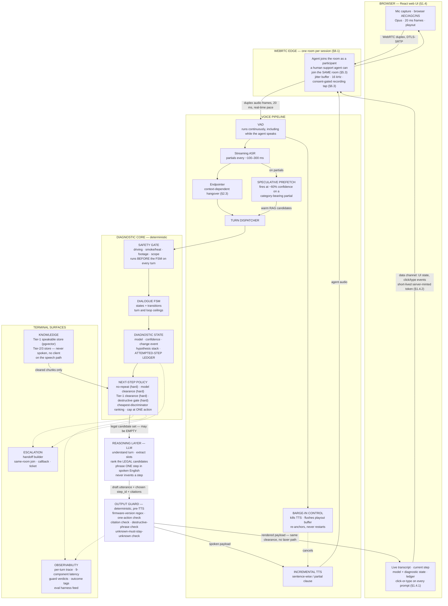

# Rove Voice Troubleshooting Agent

A web-based voice agent that helps Rove dashcam owners diagnose device faults
by talking through them — the way a human support engineer would: establish
the model, establish what changed, establish what the user already tried, form
a ranked hypothesis, test the cheapest discriminating step first, and confirm
the symptom is actually gone.

It **diagnoses rather than retrieves**. It keeps diagnostic state across turns,
asks when it does not know enough yet, and hands off to a human the moment its
confidence drops or the problem leaves its scope. Every step it speaks comes
from verified Rove guidance; it never invents a fix.

It is **not a telephonic system**: the user opens a page, grants microphone
permission, and speaks over WebRTC. There is no phone call, no SIP, no PSTN.

> **Status — read this first.** This is a working system, not a finished
> product. It is live, it passes its text harnesses, and its voice leg is
> measured, not assumed. Its limits are listed in
> [Current status](#current-status) below, honestly, including the ones that
> would fail an assessment if hidden.

## How a turn works

1. The browser captures mic audio (Opus, 20 ms frames) and joins a LiveKit
   room; the agent joins the same room as a participant.
2. Silero v5 VAD marks speech; Amazon Transcribe streams partials; a
   speculative prefetch warms retrieval candidates at ~60% confidence on a
   category-bearing partial.
3. The endpointer closes the turn (context-dependent hangover), and barge-in
   kills TTS and flushes playout if the user cuts across the reply.
4. The turn router classifies intent (symptom, meta, out-of-scope, greeting,
   small talk). A vague symptom goes to the intake routine, which asks —
   model, then problem area, then specific symptom — one question at a time.
5. Triage assigns the taxonomy ID (or `KNOWN-GAP` / `NO_MATCH`); MODEL_ID
   runs the 7-probe model-ID ladder (CONFIRMED / PROBABLE / UNKNOWN);
   retrieval runs hybrid BM25 + Titan dense over the Tier-1 speakable store,
   and the next-step policy hands the LLM a **legal** candidate set and
   nothing else.
6. The LLM ranks the legal candidates and phrases one step in spoken English.
   The deterministic output guard checks it (firmware-version regex,
   internal-marker/leak check, unsupported-cause check, and Tier-1 citation
   check) before anything is synthesised or rendered. The one-action cap is
   enforced by the next-step policy, destructive steps are held by the
   `DESTRUCTIVE_GATE` state, and unknown-must-stay-unknown is the model-ID
   ladder's confidence rule — none of those three is a guard check.
7. Amazon Polly (neural) speaks the reply; the same cleared payload renders
   in the UI panels. The turn, its latency breakdown and its guard verdicts
   are traced.

If the problem is a suspected brick, an out-of-scope request, a hazard, or the
user asks for a human, the agent escalates: a human joins the **same** LiveKit
room and takes over there.

## Architecture

The diagram below is copied verbatim from `docs/08-diagrams.md` §1 (source:
`docs/06-architecture.md` §1.1–1.2). The shape to read off it: a diagnostic
state machine that calls an LLM as a bounded function. Everything that must be
*guaranteed* sits in the deterministic core; everything that is *quality*
sits in the reasoning layer. The clearance filters run **before** the LLM sees
a candidate set; the output guard runs **after** it, on both output surfaces.



One label in that diagram needs a gloss: the `GUARD` box repeats the
`docs/08` §1 wording, but in code (`agent/core.py`, `output_guard`) the
guard itself checks firmware-version spans, internal-marker/leak spans,
unsupported-cause spans, and device-specific claims with no Tier-1 citation.
The one-action cap is the next-step policy's, destructive steps are held by
`DESTRUCTIVE_GATE`, and unknown-must-stay-unknown is the model-ID ladder's
confidence rule.

## The parts, and how each works

### React client (`client/`)

The browser UI: live transcript, current step, diagnostic state (model,
confidence, hypothesis), connection stats (session / audio / RTT / jitter /
loss / playout / token), quick-reply chips, and text input — every prompt can
be answered by clicking or typing, so a turn never depends on the mic working.
`client/src/livekit.js` joins the room; `client/src/webrtc.js` is the Pipecat
SmallWebRTC fallback. The client is served by the same FastAPI process after
`npm run build`.

### FastAPI server (`server/`)

One process, one documented port (8080). It mints short-lived tokens
(HMAC-SHA256, two scopes: `join:room` for callers, `observe:room` for the
support console), serves the caller UI at `/` and the support console at
`/support`, runs the voice pipeline, and exposes the per-turn trace over
`WS /ws`. `server/config.py` reads every setting from the environment with
working defaults. `ROVE_TRANSPORT` selects the media transport (`livekit` or
`smallwebrtc` — the flip condition of decision D-02).

### LiveKit voice pipeline (`server/livekit_agent.py`, `server/transcribe.py`, `server/polly.py`, `server/endpointing.py`)

LiveKit Agents 1.0 is the voice framework (decision D-02): its room model is
the escalation design — a human joins the same room the way the agent does.
Speech-to-text is Amazon Transcribe Streaming (with a Rove vocabulary for
biasing); text-to-speech is Amazon Polly neural, synthesised incrementally;
voice activity is Silero v5. The endpointer uses context-dependent hangovers,
prefetch fires on category-bearing partials, and barge-in re-anchors instead
of restarting the turn. The 9-component latency instrumentation
(`server/latency.py`, `server/ladder.py`) records every line of every turn,
and the latency ladder steps the pipeline down a tier when the p95 over a
20-turn window breaches its margins.

### Diagnostic core — LangGraph state machine (`agent/graph.py`, `agent/core.py`, `agent/state.py`)

The diagnostic core is a LangGraph `StateGraph` implementing the hand-written
state machine (`docs/06` §8.6, decision D-13): 13 states, one node per state,
no node ever reached by model choice — there is no planner and no
tool-calling loop. The LLM is called only inside `step_triage` and
`step_select_step`, as a bounded function over a set the filter chain already
narrowed.

| # | State | What happens there |
| --- | --- | --- |
| 1 | GREET | Open the session (1 turn max) |
| 2 | SYMPTOM_CAPTURE | Hear the symptom as stated (3 turns max) |
| 3 | TRIAGE | Route, classify, assign taxonomy ID (or KNOWN-GAP / NO_MATCH) (1 turn) |
| 4 | MODEL_ID | Pin the model, via the 7-probe ladder (4 turns max) |
| 5 | HYPOTHESISE | Rank candidate causes |
| 6 | SELECT_STEP | Pick the cheapest discriminating step |
| 7 | DESTRUCTIVE_GATE | Hold any destructive step for explicit confirmation |
| 8 | PROPOSE_STEP | Speak the one step |
| 9 | AWAIT_OUTCOME | Wait for what the user reports back |
| 10 | EVALUATE_OUTCOME | Judge whether the step helped |
| 11 | VERIFY_RESOLVED | Confirm the symptom is actually gone |
| 12 | ESCALATE | Hand to a human (only exit is CLOSE) |
| 13 | CLOSE | Terminal — nothing transitions out |

Edges are `agent.state.LEGAL_TRANSITIONS`, imported, never re-typed, with an
import-time assert; every transition goes through `DiagnosticState.transition`,
which raises on an illegal move. Five interrupts are checked before every
transition — `HAZARD_STOP`, `DRIVING_GATE`, `PRESERVE_FOOTAGE`,
`OUT_OF_SCOPE`, `USER_REQUESTS_HUMAN` — and any one routes to ESCALATE.
Global ceilings: 12 diagnostic turns, 2 attempted next-steps, 3 turns on the
same top hypothesis.

The **intake routine** (`agent/intake.py`) is not a 14th state: it runs inside
TRIAGE, consulted by `step_triage` when the symptom is vague. It asks model,
then problem area, then specific symptom, one question at a time, gives up
after two "I don't know" rounds on the same slot, and hands back to triage
once the slots are filled. A turn router (`agent/router.py`, five intents:
symptom, meta, out-of-scope, greeting, small talk) plus a device-scope gate
and a context gate sit in front of it, so meta questions ("what cameras do
you support?"), jokes, and questions about other things are answered or
escalated, never diagnosed as if they were dashcam faults.

### Retrieval and grounding (`agent/retrieval.py`, `agent/store.py`, `ingest/`)

Hybrid retrieval: BM25 + Titan dense at 0.5 / 0.5, model-first filtering,
over a Postgres 18 + pgvector store of 213 atomic chunks drawn from 28
registry entries (`data/processed/chunks.jsonl`, `data/processed/sources.json`;
Titan Embeddings v2, 1024-dim). The speakable rule is structural, not a
prompt: the store enforces Tier 1 only (`CHECK (tier = 1)`), so a Tier-2 or
Tier-3 fact cannot reach the speech path however the model phrases it. The
corpus is Rove manuals and Help Center bodies, with a three-layer clearance
(Tier 1 speakable, Tier 2 candidates, Tier 3 never read by ingest). A
known-issue watch (`ingest/known_issues.py`) tracks Help Center, firmware
and app-changelog signals as Tier-2 candidates only.

### Eval harnesses (`eval/`)

Three harnesses over a 30-scenario golden set (`docs/03`):

- **Harness A** — text leg: the 30 scenarios against the diagnostic core.
  M3 next-step accuracy, M4 no-repeat, M5 harmful advice, M6 escalation
  correctness.
- **Harness B** — branch coverage: 16 branches, M4/M5/M6 per branch.
- **Harness C** — voice leg: the same scenarios spoken through real rooms,
  with noise and ASR-corruption passes. M10 compares the voice leg's next
  step against the typed leg's on the same turn; M7 is end-to-end latency
  from end of user speech to first audible response.

A grounding pack (`eval/grounding_pack/`) scores cited claims against their
source chunks with a two-grader rubric. Every harness run writes per-turn
traces; nothing about accuracy is claimed from a single draw where the
ranking is deliberately stochastic (see Current status).

### Support console (`support/`)

A second browser app at `/support` for the human in the loop: an observer
token (`observe:room`) that can watch a room, see the transcript and
diagnostic state, and join the same room to take over. Observer tokens are a
separate single scope and are refused on every caller surface.

### HTTPS / wss relay (`server/livekit_relay.py`)

The FastAPI server relays LiveKit signalling over `wss` so a browser on
plain HTTP/HTTPS can reach the media server; the token check is the gate.

## Current status

Master is at `2d72f80` (Milestone 6.8). Verified on the host, 2026-11-09:

| Check | Result |
| --- | --- |
| Full unit suite | 456 tests OK |
| Harness A (text, 30 scenarios) | M6 30/30 |
| Harness B (16 branches) | 16/16, M4 100%, M5 0 |
| Harness C (voice, last full 47-case run, Milestone 6.4) | M10 44/47, 1 error, M7 median 2095 ms (46 turns) |
| Harness C clean-pass re-run after the 6.4 fixes (EVAL-01–23) | M10 21/23; EVAL-04 and EVAL-07 diverged |

The M10 figure is the honest headline: **Phase 3 exit on M10 is NOT MET as a
single-run 100% (44/47)**. The three divergences in that full run were
`clean:EVAL-10`, `noise:EVAL-21`, and a harness error on
`corruption:barge_in_mid_reply` ("no reply to barge in on") — not the three
divergences from the earlier 6.3 run. Those earlier three are fixed in the
full run: the mis-segmented turn (a harness defect — the turn compared two
different states, fixed by replaying turns in order), `clean:EVAL-27`, and
`noise:EVAL-30` all match now. The 6.4 diagnosis found the divergences were
not modality defects (the same cases flip between runs), and the FW-02
escalation trigger that the reasoner could switch off is now pinned in
`agent/core.py`. What is still open is the criterion itself: whether M10
should be judged against a deterministic tiebreak or a same-modality repeat
baseline, given the ranking inside an entry is delegated to the model by
design and one draw per leg cannot reach 100% against a stochastic ranker.

Latency is the other open gap. The design budget (`docs/06` §2.2) is ~476 ms
best / ~860 ms median / ~2.47 s p95; the measured M7 median on the last full
voice run was 2095 ms, against the repo's own lines of 800 ms as the
aspiration, ~860 ms as the plan, and 1.2 s as the M7 line (`docs/06` §2.2).
Diagnostic correctness is never sacrificed to hit the latency target.

Also open: provenance attestation of the operator-uploaded manuals is pending;
the grounding pack still needs its second human grader; FW-03 stays
escalation-bound until a known-issue feed exists; the browser-leg re-test
(10-minute hold, drop-and-rejoin, latency lines 1 and 9) is still unrun.

## Repository map

```text
agent/      Diagnostic core: LangGraph graph, FSM, policy, router, intake,
            retrieval, store, LLM clients, answers
server/     FastAPI app, LiveKit voice agent, Transcribe, Polly, endpointing,
            latency + ladder, tokens, relay, support API, traces
client/     React caller UI (Vite)
support/    Support console (observer app)
ingest/     Corpus ingest, chunking, metadata, known-issue watch
eval/       Harnesses A/B/C, golden set, grounding pack, probe batteries
data/       Raw manuals + Help Center (raw/), extracted text (text/),
            processed chunks + registry (processed/); traces are gitignored
docs/       01 problem definition, 02 taxonomy, 03 golden eval set,
            04 data sources, 05 verification, 06 architecture,
            07 decision log (D-01–D-17, constraints C-1/C-2),
            08 diagrams, codeboarding/ (as-built component map),
            langgraph-state-machine.jpg
scripts/    Developer utilities
```

## Running it locally

Prerequisites: Python 3.14, Node, PostgreSQL 18 + pgvector, a LiveKit server
binary, and AWS credentials with access to Bedrock (Nova Pro/Micro, Titan
Embeddings v2), Transcribe and Polly in `us-east-1`. No model needs an access
request — the runtime uses only AWS models available without one (constraint
C-2).

```bash
python3 -m venv .venv
# No dependency manifest exists in the repo yet (no requirements.txt,
# pyproject.toml or setup.py) — the Python deps were installed ad hoc into
# the EC2 venv, unpinned. Install the direct deps explicitly:
.venv/bin/pip install fastapi uvicorn boto3 amazon-transcribe langgraph \
  livekit-agents livekit-plugins-silero psycopg[binary] websockets httpx \
  pydantic numpy
# Postgres: database `rove`, role matching your user, pgvector extension
#   DSN shape: postgresql://<user>@/rove?host=/var/run/postgresql

~/livekit-server/livekit-server --dev   # media server, loopback, dev keys

cd client && npm install && npm run build && cd ..   # writes client/dist
.venv/bin/python -m server              # http://<this-host>:8080/
```

Two pages from the one process: the caller UI at `/` and the support console
at `/support`. Without a client build either page returns 503 with the
command to run. Verify end to end with `.venv/bin/python -m server.verify`.

Configuration is all environment variables (`server/config.py`): the token
secret (`ROVE_TOKEN_SECRET`), support key (`ROVE_SUPPORT_KEY`), public IP
(`ROVE_PUBLIC_IP`, or `auto`), LiveKit keys (`ROVE_LIVEKIT_API_KEY` /
`ROVE_LIVEKIT_API_SECRET`), transport (`ROVE_TRANSPORT=livekit` or
`smallwebrtc`), chunks path, trace directory, and the Transcribe vocabulary
name. AWS credentials are never committed: they live in `~/.aws/credentials`
on the operator's machine, never in this repo.

## Live demo

A demo is running on an EC2 instance at <http://3.92.152.155/> (HTTP) and
<https://3.92.152.155:8443/> (HTTPS, self-signed testing-only certificate).
It runs on LiveKit's published dev keys, so it is an open media server by
design of the demo, not of the architecture: anyone who opens the URL can
start a Bedrock-backed session. Do not treat the demo URL as a production
deployment.

## Design record

| Doc | What it is |
| --- | --- |
| [docs/01-problem-definition.md](docs/01-problem-definition.md) | Problem, users, scope, success metrics |
| [docs/02-issue-taxonomy.md](docs/02-issue-taxonomy.md) | Issue taxonomy (28 issues, plus Category H) |
| [docs/03-golden-eval-set.md](docs/03-golden-eval-set.md) | Golden eval set (30 scenarios) |
| [docs/04-data-sources.md](docs/04-data-sources.md) | Data sources and corpus inventory |
| [docs/05-step1b-verification.md](docs/05-step1b-verification.md) | Source verification pass |
| [docs/06-architecture.md](docs/06-architecture.md) | **Architecture, build plan, open decisions** |
| [docs/07-decision-log.md](docs/07-decision-log.md) | **Decision log (D-01–D-17, C-1, C-2)** |
| [docs/08-diagrams.md](docs/08-diagrams.md) | **Diagrams (Mermaid)** |
| [docs/codeboarding/overview.md](docs/codeboarding/overview.md) | As-built component map |
| [docs/langgraph-state-machine.jpg](docs/langgraph-state-machine.jpg) | LangGraph state machine, drawn from `agent.state.LEGAL_TRANSITIONS` |

See also [docs/README.md](docs/README.md), [agent/README.md](agent/README.md),
[server/README.md](server/README.md), [client/README.md](client/README.md),
[eval/README.md](eval/README.md), [ingest/README.md](ingest/README.md) and
[data/README.md](data/README.md).

## What is deliberately not built

Phone/SIP fallback, end-to-end speech-to-speech, multilingual support,
footage upload, device telemetry, and a firmware version catalogue. Phase 4
is a supervised pilot (live sessions, real transcripts, real M8 baseline);
Phase 5 is a narrow production launch on the categories with the strongest
Tier-1 coverage, expanding only on measured evidence.

## Assessment notes

This repository is submitted as an interview assessment. The design record
(`docs/`) is the argument; the code is the evidence for it; the eval
harnesses are the check on both. Where the implementation departs from the
design, the departure is recorded in `docs/07`, in `eval/README.md`, or in
`docs/codeboarding/` with the measurement that justifies it — nothing is
silently substituted. The
known gaps in [Current status](#current-status) are part of the submission,
not footnotes to it.
