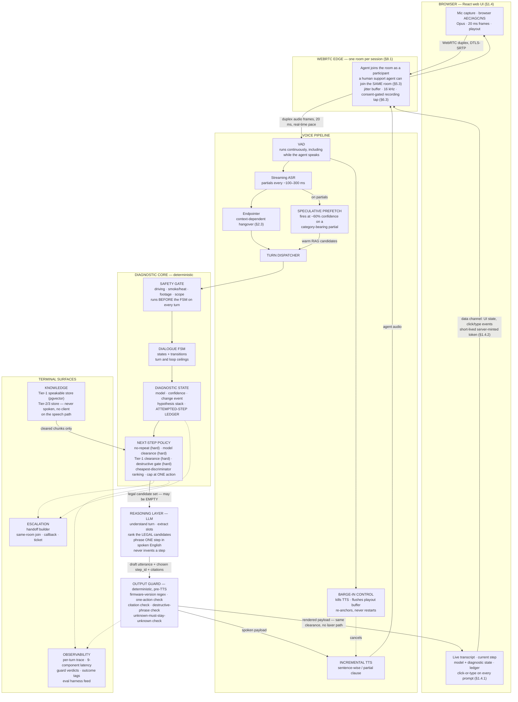
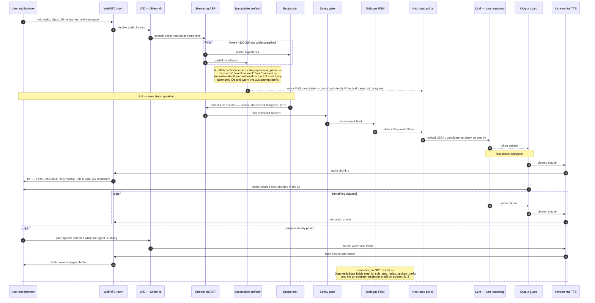
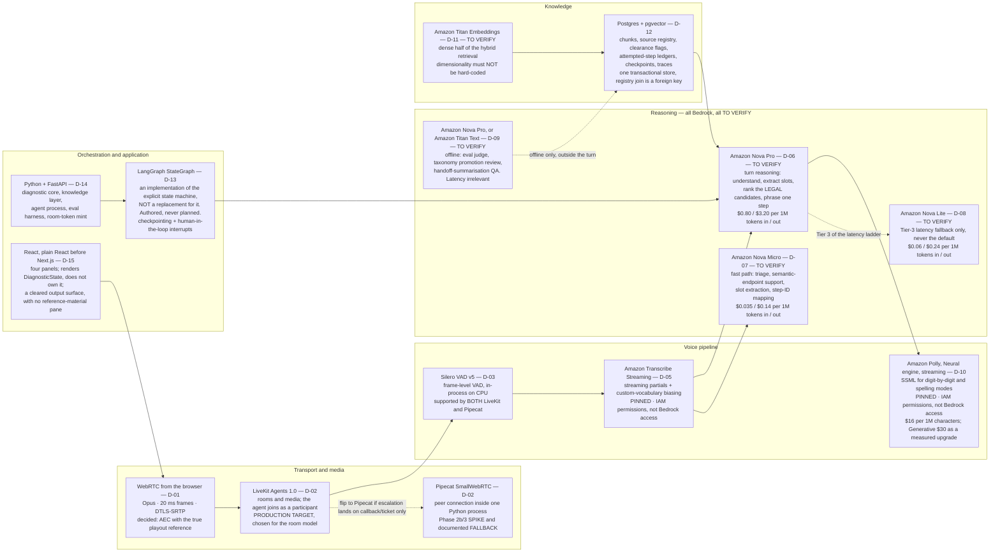

# 08 — Diagrams: Rove Voice Troubleshooting Agent

Status: **Step 2 companion. Design only. No code.**
Date: 2026-11-07
Mermaid-source companion to [`06-architecture.md`](06-architecture.md) and
[`07-decision-log.md`](07-decision-log.md).

---

## What this document is, and what it is not

`06` renders its diagrams as ASCII art inside the prose, which reads well in a terminal and
cannot be re-rendered, re-coloured, embedded in a slide, or diffed meaningfully. This
document carries the **same** structures as Mermaid source, so they can be rendered by
GitHub, by an IDE preview, or by any Mermaid tool.

**It adds nothing.** Every box, edge, state, number, model name and price below is drawn from
`06` or `07`. Where `06` marks something `TO VERIFY`, so does this document. Where `06` says
a number is a *budget* rather than a measurement, this document repeats that. Nothing here is
promoted, rounded, or firmed. If a diagram and its source section disagree, **`06` wins** and
this file is the thing that is wrong.

**On the model names.** Under `06` §0.2's hard constraint — AWS models only, and only those
AWS grants without asking — every **Bedrock** model below is marked **TO VERIFY** in the
target region, because default-enabled status is a console fact and not a document fact
(`06` §8.3, `07` C-2). **Amazon Transcribe and Amazon Polly are not Bedrock models**: they
are managed services governed by IAM permissions, which is why `06` §8.2 and §8.4 pin them
and this document does not mark them `TO VERIFY`.

| Diagram | Renders | Source |
|---|---|---|
| 1 | System architecture | `06` §1.1, §1.2 |
| 2 | Voice turn, end to end | `06` §2.1, §2.2 |
| 3 | Diagnostic state machine | `06` §3.2, §3.4 |
| 4 | Framework and model responsibilities | `06` §8, `07` D-01 … D-15 |
| 5 | Data and RAG flow | `06` §4 |
| 6 | Accuracy assurance | `06` §1.3, §7 |

---

## 1. System architecture

From **`06` §1.1 "The shape of the thing"** and **§1.2 "Component responsibilities"**. The
shape to read off it: this is not an LLM with a microphone bolted on, it is a **diagnostic
state machine** that calls an LLM as a bounded function. Everything that must be *guaranteed*
sits in the deterministic core; everything that is *quality* sits in the reasoning layer. The
clearance filters run **before** the LLM sees a candidate set, and the output guard runs
**after** it and before anything is synthesised or rendered.

Two edges in that graph carry most of the design's weight, and both are stated in `06` §1.3:
the policy layer hands the LLM a **legal** candidate set and nothing else, and the output
guard's verdict is applied to **both** output surfaces. A step that may not be spoken may not
be displayed.

---

## 2. A voice turn, end to end

From **`06` §2.1 "Flow"**, with the barge-in behaviour from the same section. `t=E` is the
moment the user stops speaking; `t=F` is the first audible response, and the gap between them
is what **M7** measures.

### The latency budget behind it

From **`06` §2.2**, reproduced without change. **All three columns are budgets, not
measurements** — no pipeline exists and nothing has been built. They exist to make the
trade-offs arguable and to give the instrumentation something to compare against.

| # | Component | Best case | Target median | p95 ceiling | Notes |
|---|---|---:|---:|---:|---|
| 1 | Browser capture → WebRTC uplink + jitter buffer | 15 ms | 25 ms | 70 ms | Opus, 20 ms frames, DTLS-SRTP |
| 2 | **Endpoint decision** (Silero VAD v5 hangover + semantic classifier) | **150 ms** | **250 ms** | 650 ms | Largest controllable line item; bought with diagnostic accuracy (§2.3) |
| 3 | ASR final flush after endpoint | 40 ms | 80 ms | 200 ms | Finalisation and punctuation only |
| 4 | Safety gate + FSM + policy filters | 5 ms | 20 ms | 50 ms | Pure in-process logic over a typed state record |
| 5 | RAG retrieval **not hidden by prefetch** | 0 ms | 30 ms | 240 ms | 0 on a prefetch hit; 240 ms is the full cold path |
| 6 | **LLM time-to-first-token** | **180 ms** | **300 ms** | 850 ms | Dominated by prompt length; cached prefix is the lever |
| 7 | **TTS time-to-first-audio** | **70 ms** | **120 ms** | 320 ms | Needs synthesis that emits on a partial clause |
| 8 | Output guard | <1 ms | 5 ms | 10 ms | Regex and set membership. Never skipped |
| 9 | WebRTC downlink + browser playout | 15 ms | 30 ms | 80 ms | Includes the playout buffer barge-in must flush |
| | **Total** | **~476 ms** | **~860 ms** | **~2.47 s** | |

Three readings `06` §2.2 attaches to that table, carried here so the numbers are not quoted
loose:

- **Lines 2, 6 and 7 together are 78 % of the target median.** Everything else is noise. Do
  not spend engineering effort on lines 1, 4, 8 or 9 — the two transport lines together are
  55 ms.
- **The target median lands at ~860 ms, ~60 ms over the 800 ms bar.** The only line big
  enough to close that gap is line 2, and line 2 is bought with diagnostic accuracy. Report
  800 ms as the aspiration, ~860 ms as the plan, and `01` M7's 1.2 s as the line that must
  not be crossed at the median. Whether the bar is a requirement or an aspiration is
  `06` §9.3 item 10 — a product decision.
- **The best-case column is a p25 figure, not a target.** It is reachable only when lines 2,
  6 and 7 all land aggressively at once, on a cached prompt prefix, with a prefetch hit, on a
  good connection.

---

## 3. The diagnostic state machine

From **`06` §3.2 "States"**, with the model-ID ladder from **§3.4**. The interrupts are
evaluated **before every transition**, and any one of them leaves the main path. The ceilings
are what force termination — they are the implementation of `01` §5's "silent escalation
failure" and `02`'s cross-cutting triggers 1 and 2.

```mermaid
flowchart TD
    subgraph INTERRUPTS["INTERRUPTS — evaluated before EVERY transition"]
        direction LR
        H["HAZARD_STOP<br/>smoke · burning smell · swelling<br/>heat damage · exposed wiring"]
        D["DRIVING_GATE<br/>deferred, not diagnosed"]
        PF2["PRESERVE_FOOTAGE<br/>REC-01 preserve-first"]
        OOS["OUT_OF_SCOPE<br/>billing · RMA · warranty · non-Rove<br/>RS2 / RS4 borescopes"]
        URH["USER_REQUESTS_HUMAN<br/>immediate, no troubleshooting toll"]
    end

    GREET["GREET<br/>consent disclosure, spoken and shown<br/>ceiling: 1 turn"]
    SYM["SYMPTOM_CAPTURE<br/>verbatim symptom + change event + already-tried<br/>ceiling: 3 turns"]
    TRI["TRIAGE<br/>category → taxonomy ID → KNOWN-GAP? → NO_MATCH?<br/>ceiling: 1 turn"]

    subgraph MID["MODEL_ID — may run in parallel or be DEFERRED (lazy, §3.4)"]
        direction TB
        MI["MODEL_ID<br/>ceiling: 4 turns, then UNKNOWN and model-agnostic only"]
        subgraph LADDER["7-probe discriminator ladder — identify by FEATURE, never by name"]
            direction TB
            L1["1 · SSID on the camera screen — read or typed<br/>splits EVERYTHING · highest reliability"]
            L2["2 · Lens count: 1 / 2 / 3<br/>R2-4K or PRO · DUAL or DUAL PRO · R3"]
            L3["3 · Touchscreen or side buttons<br/>THE R2-vs-R3 answer"]
            L4["4 · Plug reversible or one-way<br/>USB-C vs mini-USB revision split"]
            L5["5 · Underside serial label R2XXXXXXXXX<br/>medium by voice, high when typed"]
            L6["6 · Wi-Fi band behaviour<br/>low on its own, corroborative"]
            L7["7 · In-box CPL filter and rear camera<br/>low-medium, corroborative"]
            L1 --> L2 --> L3 --> L4 --> L5 --> L6 --> L7
        end
        CONF["CONFIRMED — two independent signals agree,<br/>at least one not a spoken model name<br/>typed SSID counts on its own"]
        PROB["PROBABLE — one signal<br/>family-level steps only"]
        UNK["UNKNOWN — cross-model chunks only"]
        MI --> LADDER
        LADDER --> CONF
        LADDER --> PROB
        LADDER --> UNK
    end

    HYP["HYPOTHESISE<br/>rank causes from 02<br/>re-rank on change event"]
    SEL["SELECT_STEP — policy, §3.5<br/>source · model · no-repeat · safety filters<br/>rank by discriminating power · cap at ONE action"]
    DG["DESTRUCTIVE_GATE<br/>cause + consequence-spoken-first + explicit consent<br/>refusal is final for that step"]
    PROP["PROPOSE_STEP<br/>exactly ONE action<br/>enforced by the output guard"]
    AW["AWAIT_OUTCOME<br/>long hangover, 'tell me when you've done that'<br/>no turn limit; a 90 s silence prompts once"]
    EV["EVALUATE_OUTCOME<br/>symptom gone?"]
    UPD["update ledger + hypothesis stack"]
    VER["VERIFY_RESOLVED<br/>user states the symptom is gone"]
    CLOSE["CLOSE<br/>resolved_verified · non_fault_closed_honestly<br/>deferred_retest · not-closed"]
    ESCALATE["ESCALATE<br/>handoff built and delivered<br/>supported as a CONCURRENT action, not only terminal"]

    CEIL["GLOBAL CEILINGS — any one forces ESCALATE<br/>· 2 next-steps attempted, symptom unchanged<br/>· same top hypothesis survives 3 turns with no new information<br/>· 12 total diagnostic turns<br/>· legal candidate set is empty<br/>· taxonomy entry is UNVERIFIED and no cross-model cleared step exists"]

    INTERRUPTS -.->|"any fires → leaves the main path"| ESCALATE
    GREET --> SYM --> TRI
    TRI -->|"taxonomy ID"| MID
    TRI -->|"NO_MATCH — this is EVAL-28"| ESCALATE
    TRI -->|"KNOWN-GAP: acknowledge, surface the single Tier-1 fact,<br/>otherwise escalate with full context"| ESCALATE
    MID --> HYP
    TRI --> HYP
    HYP --> SEL
    SEL -->|"legal set EMPTY"| ESCALATE
    SEL -->|"step is destructive"| DG
    DG -->|"consent granted"| PROP
    DG -->|"refused"| SEL
    SEL -->|"step is not destructive"| PROP
    PROP --> AW --> EV
    EV -->|"no"| UPD
    UPD --> CEIL
    CEIL -->|"ceiling reached"| ESCALATE
    CEIL -->|"headroom remains"| SEL
    EV -->|"yes"| VER
    VER --> CLOSE
```

Three things the diagram encodes that are easy to lose in prose:

- **`MODEL_ID` is lazy.** It runs only when the policy layer finds the candidate steps
  diverge by model. `03` EVAL-01 is explicit that asking for the model first is *wrong*
  there, because it does not change the next question.
- **Escalation is not only terminal.** `FW-02` escalates *in parallel with* the card-out
  question rather than after it, so the FSM supports escalation as a concurrent action.
- **`FAMILY.OBSERVE` is exempt from the no-repeat block** (`06` §3.6). Asking someone to read
  the screen again, after something has changed, is not repetition.

---

## 4. Framework and model responsibilities

From **`06` §8** and the matching entries in **`07`**. Read it as a responsibility map, not a
dependency graph: each node is one layer of the stack, the technology chosen for it, and the
decision ID where the alternatives and the flip condition are recorded.

**Every Bedrock model row is `TO VERIFY` in the target region** (`06` §0.2, §8.3). Transcribe
and Polly are managed services on IAM permissions, **not** Bedrock model access, which is why
they are pinned instead.

The one decision that chose two others, worth stating because it is not visible in the graph:
`06` §8.1.1's first and heaviest reason for LiveKit is that **escalation is a hard
requirement and the room model satisfies it directly**. D-17's same-session join is the whole
argument for D-02, and D-02's React affinity is the whole argument for D-15. `06` puts it
plainly: *we are not choosing a framework for the happy path; we are choosing it for the
handoff, because the handoff is the part that is expensive to retrofit.*

---

## 5. Data and RAG flow

From **`06` §4** — corpus (§4.1), chunking (§4.2), metadata (§4.3), the source registry
(§4.4), the speakable rule (§4.5) and metadata filtering (§4.6). The governing rule of the
retrieval half is **filter first, then search — never semantic-only**, and `06` §4.6 is
explicit that model filtering here is a **safety** control, not relevance tuning: the card
ceiling is 512 GB on R2-4K / PRO / R3 and up to 1 TB on DUAL / DUAL PRO, so an unfiltered
search for "how big a card can I use" returns both, and either answer is wrong for half the
line.

```mermaid
flowchart TD
    subgraph SRC["Tier 1 corpus — exactly 21 documents (§4.1)"]
        direction LR
        S1["6 manuals — 260 pages<br/>M1…M6"]
        S2["3 official Rove pages<br/>O1…O3"]
        S3["12 Help Center articles<br/>H:name"]
    end

    CHUNK["CHUNKING (§4.2)<br/>manuals: one named section, 200–400 tokens;<br/>troubleshooting tables one ROW per chunk<br/>official pages: one H2/H3, 200–400 tokens;<br/>O2's Wi-Fi table one row per MODEL<br/>Help Center: one article or step-group, 150–350 tokens"]
    ATOMIC["THE OVERRIDING RULE: A PROCEDURE IS ATOMIC<br/>procedures are never split — if one exceeds the chunk<br/>budget, the chunk exceeds the budget.<br/>FW-01: the wrong advice here destroys the device"]

    META["METADATA + CLEARANCE FLAGS (§4.3)<br/>chunk_id · doc_code · source_path · source_url · retrieval_date<br/>tier · provenance · page_range · section<br/>model_applicability (explicit, never 'all') · hw_revision_specific<br/>firmware_applicability = unknown, deliberately degenerate<br/>category · taxonomy_ids · step_ids<br/>verification_status · speakable · destructive<br/>safety_critical · expectation_gap"]
    REG["SOURCE REGISTRY (§4.4)<br/>keyed by doc_code: source_url, retrieval_date, tier,<br/>provenance, content hash, licence note.<br/>A chunk missing any required field is NOT indexed.<br/>OPEN: 5 of the 6 manuals were hand-uploaded and have no URL —<br/>proposed provenance: operator_attested, prototype only"]

    EMB["Amazon Titan Embeddings — TO VERIFY (§8.5)<br/>dimensionality set by whichever model the console allows"]
    T1STORE["TIER-1 SPEAKABLE STORE<br/>Postgres + pgvector"]
    T23["TIER-2/3 STORE — PHYSICALLY SEPARATE (§4.5)<br/>Amazon / app-store reviews, comparison sites, YouTube.<br/>Neither the speech path NOR the UI payload builder<br/>has a client for it. Not a flag — a different connection."]
    T23JOBS["Tier 2/3 has exactly TWO jobs, neither reaching the user:<br/>symptom-language matching for the router,<br/>and eval-scenario authoring.<br/>Output into the live path is a CATEGORY HINT WITH NO TEXT"]

    Q["User turn → query"]
    F1["FILTER 1 · MODEL (§4.6)<br/>CONFIRMED → model + hw_revision chunks<br/>PROBABLE → chunks covering ALL still-live candidates<br/>UNKNOWN → cross-model chunks only"]
    F2["FILTER 2 · CATEGORY<br/>triaged category ∪ cross-cutting"]
    F3["FILTER 3 · SPEAKABLE<br/>speakable == true<br/>drops UNVERIFIED and REJECTED:<br/>FW-03, APP-02, APP-04, PWR-02, SD-02"]
    HYB["HYBRID SEARCH, k = 8<br/>0.5 · BM25 over query + taxonomy_id + step vocabulary<br/>+ 0.5 · dense"]
    RR["RERANK → top 3"]
    POL["POLICY FILTERS (§3.5)<br/>source clearance · model clearance · no-repeat<br/>safety · destructive gate · rank · cap at ONE action"]
    LLMN["LLM — rank within the LEGAL set, phrase one step<br/>structured output must name the backing chunk_ids"]
    OG["OUTPUT GUARD<br/>firmware-version regex · one-action · citation<br/>destructive-phrase · unknown-stays-unknown"]
    OUT1["SPOKEN"]
    OUT2["RENDERED — same guard, no laxer path"]

    S1 --> CHUNK
    S2 --> CHUNK
    S3 --> CHUNK
    CHUNK --> ATOMIC --> META
    META --> REG
    REG -->|"no chunk without a registry entry is indexed"| EMB
    EMB --> T1STORE
    T23 --- T23JOBS
    T23JOBS -.->|"category hint, no text"| F2

    Q --> F1 --> F2 --> F3 --> HYB
    T1STORE --> HYB
    HYB --> RR --> POL --> LLMN --> OG
    OG --> OUT1
    OG --> OUT2
```

What this flow costs, stated as `06` §4.5 states it: **`FW-03` — "something broke after the
update" — is undiagnosable under the speakable rule**, because there is no known-issue feed.
The agent's correct behaviour on those sessions is to capture context and escalate. That is a
known, accepted hole and the strongest single argument for the internal feed in `06` §9.3
item 1.

---

## 6. Accuracy assurance

From **`06` §1.3** (the three-layer clearance model) and **§7** (metrics, harnesses, judge
validation, observability). The distinction `06` §7.1 insists on, carried into the diagram:
some of `01` §6 are **targets**; two are **hard constraints**, and those are not targets at
all. The metric does not make them true — **the metric proves the code works**. A non-zero M5
is a code defect, not a model regression, and it is handled as an incident.

```mermaid
flowchart TD
    subgraph CLR["THREE-LAYER CLEARANCE (§1.3) — nothing reaches the user, spoken OR rendered, without all three"]
        direction TB
        C1["1 · SOURCE CLEARANCE<br/>chunk is Tier 1, has a registry entry,<br/>and its taxonomy entry is VERIFIED or CORRECTED in 05"]
        C2["2 · MODEL CLEARANCE<br/>model_applicability includes the CONFIRMED model<br/>and hardware revision, or the chunk is cross-model"]
        C3["3 · POLICY CLEARANCE<br/>not in the attempted-failed ledger,<br/>not destructive without the three-part gate,<br/>and a single action"]
        C1 --> C2 --> C3
    end
    EMPTY["A step failing any of the three is NOT softened, hedged or reworded —<br/>it is REMOVED from the candidate set.<br/>If the set empties: say so, and escalate.<br/>Honest uncertainty as a DATA FLOW, not a personality trait"]

    subgraph HARD["HARD CONSTRAINTS — runtime invariants, not targets (§7.1)"]
        direction TB
        M4["M4 · NO-REPEAT = 100%<br/>zero proposals of a step already no_change or worse.<br/>Enforced by the policy filter over the attempted-step ledger.<br/>ANY BREACH IS A P1 DEFECT"]
        M5["M5 · HARMFUL ADVICE = 0<br/>destructive step without cause + consequence + consent;<br/>any step to a driving user; any footage-risking step with<br/>footage at stake; any firmware downgrade.<br/>COUNTED ON BOTH OUTPUT SURFACES"]
    end

    subgraph ADD["THE THREE METRICS THIS ARCHITECTURE ADDS (§7.2)"]
        direction TB
        GR["GROUNDING RATE — target 100%<br/>proportion of device-specific claims carrying at least one<br/>cleared Tier-1 chunk citation, across BOTH surfaces.<br/>Enforced by the output guard, measured from traces"]
        UH["UNKNOWN-HANDLING RATE<br/>on the 4 UNVERIFIED entries and the KNOWN-GAP symptoms:<br/>admits it cannot verify and escalates, versus<br/>producing something plausible"]
        M10["M10 · MODALITY INDEPENDENCE — target 100%<br/>a sampled answer is replayed through the OTHER modality —<br/>a spoken yes re-run as a click, a typed SSID as a transcript —<br/>and the resulting next step must be IDENTICAL.<br/>A divergence is a DEFECT, not a quality score"]
    end

    subgraph GOLD["THE 30-SCENARIO GOLDEN SET (§7.3) — grades the NEXT STEP, not the reply"]
        direction TB
        HA["HARNESS A — text-only, single turn, the default loop<br/>utterance + known context as a pre-populated DiagnosticState.<br/>Seconds to run; runs on every prompt or policy change.<br/>M10 RUNS HERE, cheaply — both modalities are just events"]
        HB["HARNESS B — scripted multi-turn<br/>EVAL-23/26/27 plus every branching scenario<br/>(EVAL-07, 16, 17, 20, 21). A deterministic responder plays the user.<br/>Catches the agent that asks the right question then ignores the answer"]
        HC["HARNESS C — end-to-end spoken, through a REAL browser<br/>synthesised speech, road noise, laptop-speaker colouration, accents.<br/>Audio injected at REAL-TIME PACE in 20 ms frames, through an<br/>actual WebRTC peer connection — never spliced in behind the transport"]
        ASRC["THE ASR-CORRUPTION PASS — only Harness C can run it<br/>inject R2↔R3, 4K↔'forty', SD↔SB, clipped turns,<br/>mis-segmented turns, barge-in mid-instruction.<br/>TARGET IS NOT 'still gets it right' — it is<br/>'does not act on a mis-heard model', i.e. M1's UNKNOWN branch fires"]
        HA --> HB --> HC --> ASRC
    end

    subgraph JUDGE["JUDGE VALIDATION (§7.4) — the judge does not ship on assertion"]
        direction TB
        J1["1 · Two human graders score all 30.<br/>Measure inter-rater agreement, Cohen's κ.<br/>If humans do not agree, the expected next step in 03 is<br/>ambiguous and 02/03 GET FIXED FIRST"]
        J2["2 · Build the LLM judge on the offline tier<br/>and validate against the human labels.<br/>Ship it only ABOVE AN AGREED κ"]
        J3["3 · Re-validate whenever 02, 03 or the judge model changes"]
        J4["4 · HUMAN BASELINE — score a competent human support agent<br/>on the same 30, Harness A, written answers.<br/>Without it, a 70% model score means nothing"]
        J1 --> J2 --> J3
        J1 --> J4
    end

    subgraph TR["PER-TURN TRACES (§7.5) — the evidence layer under all of the above"]
        direction TB
        TR1["ASR final + confidence + alternates · THE MODALITY the answer arrived on<br/>full DiagnosticState diff · triage decision"]
        TR2["THE CANDIDATE SET BEFORE AND AFTER EACH FILTER,<br/>with the drop reason for every dropped step —<br/>this is what makes a no-repeat breach debuggable in one look"]
        TR3["retrieved chunk IDs with scores · LLM tokens in/out<br/>guard verdict on BOTH the spoken and the rendered payload<br/>the 9-component latency decomposition"]
        TR1 --> TR2 --> TR3
    end

    ALERT["ALERTS, as distinct from dashboards<br/>any M4 or M5 breach · any M10 divergence<br/>grounding rate below 100% · latency ladder reaching Tier 3<br/>knowledge layer unavailable · escalation channel unavailable<br/>during published hours · a rise in failed room joins"]

    CLR --> EMPTY
    EMPTY --> HARD
    HARD --> ADD
    ADD --> GOLD
    GOLD --> JUDGE
    GOLD --> TR
    HARD --> TR
    TR --> ALERT
    ADD --> ALERT
```

Two reporting rules `06` attaches to this picture, both of which exist to stop a number
flattering the system:

- **Escalation precision and recall are reported together, always** (§7.2, M6). The golden
  set is 4 unconditional escalations against **26 negative controls**; an all-escalate agent
  scores 4/30 on recall-weighted correctness, not 4/4.
- **Report per-axis and per-part — simple / contextual / complex / escalation — never a
  single aggregate** (§7.3). A single number lets a collapse in the contextual block hide
  behind the simple block. Hard-constraint breaches are listed individually, with the trace,
  every run.

---

## How to use this file

- **`06` is the source of truth.** If a diagram here disagrees with its source section, the
  diagram is wrong. Fix it here; do not "fix" `06` to match a picture.
- **When a decision flips** (`07`, "How to use this log"), update `07`, update the matching
  `06` subsection, and then update diagram 4 — in that order. A diagram updated first is a
  decision made in a picture.
- **The `TO VERIFY` marks are load-bearing.** When the console is read under the C-2
  procedure, the enabled list is recorded in `06` §8.3 with date and region; diagram 4's
  marks come off only then, and only for the models the console actually grants.
- **Every number here is a budget or a count from `06`.** Nothing in this document was
  measured, because nothing has been built.
