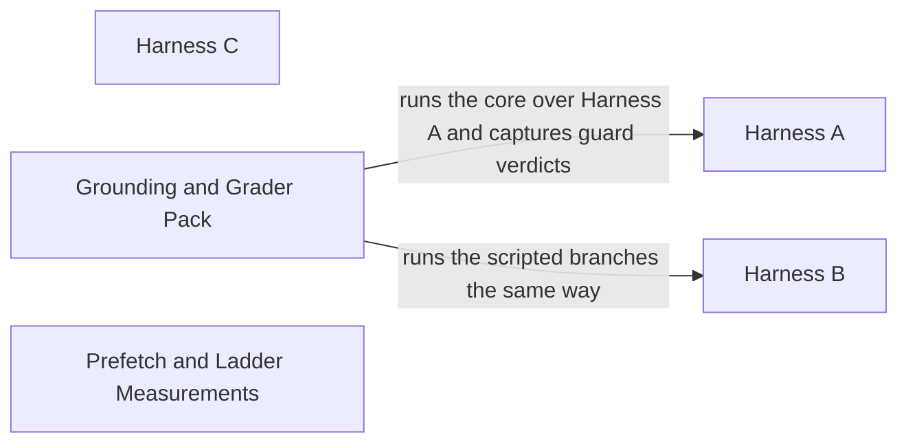

# Eval Harnesses

[Back to the overview](overview.md) · component 7

## Details

The 30-scenario golden set (`eval/scenarios.json`) scored three ways: Harness A (text, single turn), Harness B (scripted multi-turn) and Harness C (synthesised speech through a real LiveKit room), plus grounding, latency-ladder and prefetch measurements and the two-grader pack with Cohen's kappa.

### Relations

| From | To | Relation | Evidence |
|---|---|---|---|
| Grounding and Grader Pack | Harness A | runs the core over Harness A and captures guard verdicts | `eval/grounding.py:run_harness_a` |
| Grounding and Grader Pack | Harness B | runs the scripted branches the same way | `eval/grounding.py:run_harness_b` |

### Harness A

Single turn: pre-populates a `DiagnosticState` from the scenario, calls the agent once, scores the next step. `baseline.py` is the deliberately dumb floor agent.

**Related Classes/Methods**:

- [`eval/harness.py`:`run_harness`](../../eval/harness.py#L570-L593)
- [`eval/run.py`:`main`](../../eval/run.py#L30-L80)
- [`eval/baseline.py`:`DumbBaselineAgent`](../../eval/baseline.py#L68-L110)

**Source Files:**

- [`eval/harness.py`](../../eval/harness.py)
  - `run_harness` ([L570-L593](../../eval/harness.py#L570-L593)) - function
  - `score` ([L413-L492](../../eval/harness.py#L413-L492)) - function
  - `state_from_scenario` ([L286-L307](../../eval/harness.py#L286-L307)) - function
  - `Scenario` ([L72-L107](../../eval/harness.py#L72-L107)) - class
  - `build_agent` ([L357-L373](../../eval/harness.py#L357-L373)) - function
- [`eval/run.py`](../../eval/run.py)
  - `main` ([L30-L80](../../eval/run.py#L30-L80)) - function
- [`eval/baseline.py`](../../eval/baseline.py)
  - `DumbBaselineAgent` ([L68-L110](../../eval/baseline.py#L68-L110)) - class
  - `match_taxonomy` ([L59-L65](../../eval/baseline.py#L59-L65)) - function

### Harness B

Scripted multi-turn: a deterministic responder plays the user down each branch.

**Related Classes/Methods**:

- [`eval/harness_b.py`:`run_script`](../../eval/harness_b.py#L1025-L1139)
- [`eval/run_b.py`:`main`](../../eval/run_b.py#L42-L114)

**Source Files:**

- [`eval/harness_b.py`](../../eval/harness_b.py)
  - `run_script` ([L1025-L1139](../../eval/harness_b.py#L1025-L1139)) - function
  - `ScriptedResponder` ([L676-L714](../../eval/harness_b.py#L676-L714)) - class
  - `CoreDriver` ([L813-L825](../../eval/harness_b.py#L813-L825)) - class
  - `validate_scripts` ([L609-L656](../../eval/harness_b.py#L609-L656)) - function
- [`eval/run_b.py`](../../eval/run_b.py)
  - `main` ([L42-L114](../../eval/run_b.py#L42-L114)) - function

### Harness C

End to end spoken: synthesised speech with road noise, injected at real-time pace through a real LiveKit participant, with an ASR-corruption pass.

**Related Classes/Methods**:

- [`eval/harness_c.py`:`run_harness_c`](../../eval/harness_c.py#L1262-L1295)
- [`eval/run_c.py`:`main`](../../eval/run_c.py#L97-L225)

**Source Files:**

- [`eval/harness_c.py`](../../eval/harness_c.py)
  - `run_harness_c` ([L1262-L1295](../../eval/harness_c.py#L1262-L1295)) - function
  - `run_case` ([L969-L1010](../../eval/harness_c.py#L969-L1010)) - function
  - `build_cases` ([L298-L375](../../eval/harness_c.py#L298-L375)) - function
  - `synthesize_case` ([L489-L535](../../eval/harness_c.py#L489-L535)) - function
- [`eval/run_c.py`](../../eval/run_c.py)
  - `main` ([L97-L225](../../eval/run_c.py#L97-L225)) - function

### Grounding and Grader Pack

Structural grounding rate from the output guard's verdicts, the two-grader pack, and Cohen's kappa scoring.

**Related Classes/Methods**:

- [`eval/grounding.py`:`run_harness_a`](../../eval/grounding.py#L454-L464)
- [`eval/run_grounding.py`:`main`](../../eval/run_grounding.py#L89-L189)
- [`eval/build_grounding_pack.py`:`build`](../../eval/build_grounding_pack.py#L221-L325)

**Source Files:**

- [`eval/grounding.py`](../../eval/grounding.py)
  - `run_harness_a` ([L454-L464](../../eval/grounding.py#L454-L464)) - function
  - `run_harness_b` ([L467-L478](../../eval/grounding.py#L467-L478)) - function
  - `structural_report` ([L372-L384](../../eval/grounding.py#L372-L384)) - function
  - `scan_turn` ([L225-L262](../../eval/grounding.py#L225-L262)) - function
- [`eval/run_grounding.py`](../../eval/run_grounding.py)
  - `main` ([L89-L189](../../eval/run_grounding.py#L89-L189)) - function
- [`eval/build_grounding_pack.py`](../../eval/build_grounding_pack.py)
  - `build` ([L221-L325](../../eval/build_grounding_pack.py#L221-L325)) - function
  - `draw_sample` ([L168-L218](../../eval/build_grounding_pack.py#L168-L218)) - function
- [`eval/score_grading.py`](../../eval/score_grading.py)
  - `cohens_kappa` ([L186-L214](../../eval/score_grading.py#L186-L214)) - function
  - `report` ([L253-L397](../../eval/score_grading.py#L253-L397)) - function

### Prefetch and Ladder Measurements

Replays that measure what speculative prefetch is worth and drive the degradation ladder until it fires and recovers.

**Related Classes/Methods**:

- [`eval/run_prefetch.py`:`measure`](../../eval/run_prefetch.py#L149-L210)
- [`eval/run_ladder.py`:`replay`](../../eval/run_ladder.py#L109-L163)

**Source Files:**

- [`eval/run_prefetch.py`](../../eval/run_prefetch.py)
  - `measure` ([L149-L210](../../eval/run_prefetch.py#L149-L210)) - function
  - `partial_stream` ([L89-L99](../../eval/run_prefetch.py#L89-L99)) - function
- [`eval/run_ladder.py`](../../eval/run_ladder.py)
  - `replay` ([L109-L163](../../eval/run_ladder.py#L109-L163)) - function
  - `measured_m7` ([L54-L71](../../eval/run_ladder.py#L54-L71)) - function
