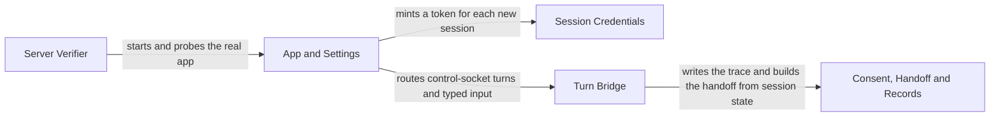

# FastAPI Server

[Back to the overview](overview.md) · component 2

## Details

One FastAPI process on one port. It mints short-lived session credentials, serves the built client, owns the control WebSocket, runs every typed turn against the diagnostic core, and holds consent, handoff, trace and transcript records. In the default transport it does not carry media.

### Relations

| From | To | Relation | Evidence |
|---|---|---|---|
| App and Settings | Session Credentials | mints a token for each new session | `server/app.py:create_app` |
| App and Settings | Turn Bridge | routes control-socket turns and typed input | `server/app.py:run_turn` |
| Turn Bridge | Consent, Handoff and Records | writes the trace and builds the handoff from session state | `server/core_bridge.py:Session` |
| Server Verifier | App and Settings | starts and probes the real app | `server/verify.py:BackgroundServer` |

### App and Settings

`create_app` assembles the routes (`/healthz`, `/api/session`, `/api/session/{room}/token`, `/api/offer`, `/api/ice`, `/api/trace/{room}`, `/ws`), the static client, the `/support` console and the support routes, and, under the livekit transport, `/lk`. `/api/offer` and `/api/ice` serve only the Pipecat fallback. `Settings` reads every option from the environment; `main` runs uvicorn.

**Related Classes/Methods**:

- [`server/app.py`:`create_app`](../../server/app.py#L486-L797)
- [`server/config.py`:`Settings`](../../server/config.py#L101-L279)
- [`server/__main__.py`:`main`](../../server/__main__.py#L26-L113)

**Source Files:**

- [`server/app.py`](../../server/app.py)
  - `create_app` ([L486-L797](../../server/app.py#L486-L797)) - function
  - `AppState` ([L89-L384](../../server/app.py#L89-L384)) - class
  - `run_turn` ([L398-L483](../../server/app.py#L398-L483)) - function
  - `broadcast` ([L387-L395](../../server/app.py#L387-L395)) - function
- [`server/config.py`](../../server/config.py)
  - `Settings` ([L101-L279](../../server/config.py#L101-L279)) - class
- [`server/__main__.py`](../../server/__main__.py)
  - `main` ([L26-L113](../../server/__main__.py#L26-L113)) - function

### Session Credentials

Mints and verifies the short-lived, single-room, single-identity tokens. `livekit_tokens` is the JWT the LiveKit media server accepts; `tokens` is the earlier token for the Pipecat fallback.

**Related Classes/Methods**:

- [`server/livekit_tokens.py`:`mint`](../../server/livekit_tokens.py#L87-L148)
- [`server/tokens.py`:`mint`](../../server/tokens.py#L225-L276)

**Source Files:**

- [`server/livekit_tokens.py`](../../server/livekit_tokens.py)
  - `mint` ([L87-L148](../../server/livekit_tokens.py#L87-L148)) - function
  - `verify` ([L151-L230](../../server/livekit_tokens.py#L151-L230)) - function
  - `Claims` ([L69-L84](../../server/livekit_tokens.py#L69-L84)) - class
- [`server/tokens.py`](../../server/tokens.py)
  - `mint` ([L225-L276](../../server/tokens.py#L225-L276)) - function
  - `verify` ([L279-L364](../../server/tokens.py#L279-L364)) - function
  - `MintedSession` ([L382-L415](../../server/tokens.py#L382-L415)) - class
  - `new_room_id` ([L418-L420](../../server/tokens.py#L418-L420)) - function

### Turn Bridge

The click-or-type path and the session registry. A click, a typed string and a transcribed utterance enter as the same event; `run_typed_turn` calls `agent.core.diagnose`, `fanout` pushes the result to every participant.

**Related Classes/Methods**:

- [`server/core_bridge.py`:`Session`](../../server/core_bridge.py#L126-L226)

**Source Files:**

- [`server/core_bridge.py`](../../server/core_bridge.py)
  - `Session` ([L126-L226](../../server/core_bridge.py#L126-L226)) - class
  - `SessionRegistry` ([L229-L267](../../server/core_bridge.py#L229-L267)) - class
  - `run_typed_turn` ([L275-L427](../../server/core_bridge.py#L275-L427)) - function
  - `fanout` ([L517-L544](../../server/core_bridge.py#L517-L544)) - function
  - `project_state` ([L570-L630](../../server/core_bridge.py#L570-L630)) - function
  - `session_snapshot` ([L654-L679](../../server/core_bridge.py#L654-L679)) - function

### Consent, Handoff and Records

Per-session consent, the escalation handoff rendered from `DiagnosticState`, the per-session JSONL trace, and consented transcripts written to Postgres (`pilot_sessions`, `pilot_transcript_lines`).

**Related Classes/Methods**:

- [`server/consent.py`:`ConsentState`](../../server/consent.py#L101-L314)
- [`server/handoff.py`:`build_handoff`](../../server/handoff.py#L366-L466)
- [`server/trace.py`:`Trace`](../../server/trace.py#L36-L136)

**Source Files:**

- [`server/consent.py`](../../server/consent.py)
  - `ConsentState` ([L101-L314](../../server/consent.py#L101-L314)) - class
- [`server/handoff.py`](../../server/handoff.py)
  - `build_handoff` ([L366-L466](../../server/handoff.py#L366-L466)) - function
- [`server/trace.py`](../../server/trace.py)
  - `Trace` ([L36-L136](../../server/trace.py#L36-L136)) - class
- [`server/transcripts.py`](../../server/transcripts.py)
  - `collect` ([L282-L416](../../server/transcripts.py#L282-L416)) - function
  - `check_consent` ([L267-L279](../../server/transcripts.py#L267-L279)) - function
  - `redact` ([L170-L183](../../server/transcripts.py#L170-L183)) - function

### Server Verifier

`python -m server.verify` starts a server, checks the mint, the media path, the trace and a typed turn, then stops it.

**Related Classes/Methods**:

- [`server/verify.py`:`run`](../../server/verify.py#L386-L398)

**Source Files:**

- [`server/verify.py`](../../server/verify.py)
  - `run` ([L386-L398](../../server/verify.py#L386-L398)) - function
  - `BackgroundServer` ([L62-L115](../../server/verify.py#L62-L115)) - class
  - `verify_mint` ([L163-L247](../../server/verify.py#L163-L247)) - function
