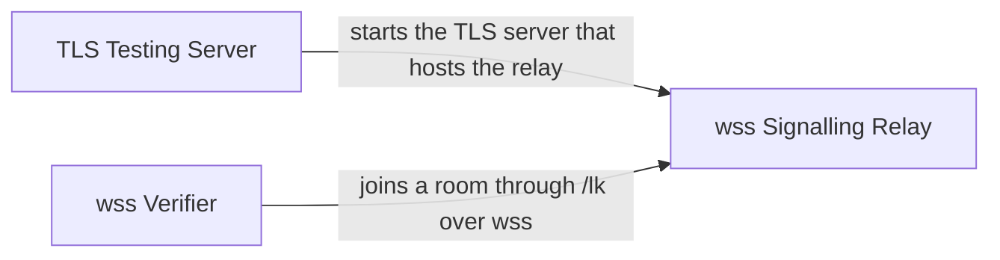

# HTTPS and wss Relay

[Back to the overview](overview.md) · component 8

## Details

A page served over https may not open `ws://`, and `livekit-server` does not terminate TLS on its signalling port. When the server runs with `ROVE_TLS_CERT` and `ROVE_TLS_KEY`, uvicorn terminates TLS and `/lk` relays only the signalling (`rtc` paths) to `settings.livekit_url` (default `ws://127.0.0.1:7880`). Media stays browser to media server. A testing-only certificate script and a headless wss verifier ship with it.

### Relations

| From | To | Relation | Evidence |
|---|---|---|---|
| TLS Testing Server | wss Signalling Relay | starts the TLS server that hosts the relay | `scripts/serve_https_testing.sh:ROVE_TLS_CERT` |
| wss Verifier | wss Signalling Relay | joins a room through /lk over wss | `server/verify_wss.py:main` |

### wss Signalling Relay

`register_livekit_relay` mounts `/lk/{path}` as a WebSocket and HTTP pass-through; only `rtc` and `rtc/...` paths (signalling and its validate probe) are forwarded to `settings.livekit_url`; anything else is closed with 1008.

**Related Classes/Methods**:

- [`server/livekit_relay.py`:`register_livekit_relay`](../../server/livekit_relay.py#L65-L130)

**Source Files:**

- [`server/livekit_relay.py`](../../server/livekit_relay.py)
  - `register_livekit_relay` ([L65-L130](../../server/livekit_relay.py#L65-L130)) - function

### TLS Testing Server

`scripts/serve_https_testing.sh` generates a throwaway CA and leaf certificate under `server/testing-tls/` and starts `python -m server` with `ROVE_TLS_CERT` and `ROVE_TLS_KEY`. Testing only. In `server/config.py`, `Settings.scheme` and `Settings.livekit_public_url` decide whether the page is handed `wss://<host>/lk`.

**Related Classes/Methods**:

- [`scripts/serve_https_testing.sh`:`ROVE_TLS_CERT`](../../scripts/serve_https_testing.sh#L9-L9)

**Source Files:**

- [`scripts/serve_https_testing.sh`](../../scripts/serve_https_testing.sh)
  - `ROVE_TLS_CERT` ([L9-L9](../../scripts/serve_https_testing.sh#L9-L9)) - reference

### wss Verifier

`python -m server.verify_wss` mints through the https page, asserts the browser would receive `wss://<host>/lk`, and joins a room through it.

**Related Classes/Methods**:

- [`server/verify_wss.py`:`main`](../../server/verify_wss.py#L27-L50)

**Source Files:**

- [`server/verify_wss.py`](../../server/verify_wss.py)
  - `main` ([L27-L50](../../server/verify_wss.py#L27-L50)) - function
