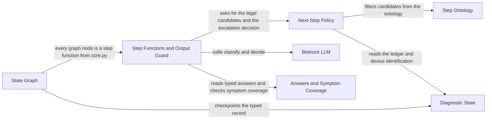

# LangGraph Diagnostic Core

[Back to the overview](overview.md) · component 4

## Details

The `agent` package: a typed `DiagnosticState`, a LangGraph `StateGraph` whose nodes are authored step functions, a next-step policy that removes illegal moves before the model sees a candidate list, a Bedrock Nova wrapper, and a deterministic output guard. `core.diagnose(utterance, state)` is the entry point.

### Relations

| From | To | Relation | Evidence |
|---|---|---|---|
| State Graph | Step Functions and Output Guard | every graph node is a step function from core.py | `agent/graph.py:build_graph` |
| State Graph | Diagnostic State | checkpoints the typed record | `agent/graph.py:make_checkpointer` |
| Step Functions and Output Guard | Next-Step Policy | asks for the legal candidates and the escalation decision | `agent/core.py:step_select_step` |
| Step Functions and Output Guard | Bedrock LLM | calls classify and decide | `agent/core.py:step_triage` |
| Step Functions and Output Guard | Answers and Symptom Coverage | reads typed answers and checks symptom coverage | `agent/core.py:step_triage` |
| Next-Step Policy | Step Ontology | filters candidates from the ontology | `agent/policy.py:candidate_steps` |
| Next-Step Policy | Diagnostic State | reads the ledger and device identification | `agent/policy.py:candidate_steps` |

### Diagnostic State

The typed record the policy reads instead of the transcript: 13 FSM states, five interrupts, the attempted-step ledger, hypotheses, device identification.

**Related Classes/Methods**:

- [`agent/state.py`:`DiagnosticState`](../../agent/state.py#L773-L997)

**Source Files:**

- [`agent/state.py`](../../agent/state.py)
  - `DiagnosticState` ([L773-L997](../../agent/state.py#L773-L997)) - class
  - `State` ([L66-L87](../../agent/state.py#L66-L87)) - class
  - `Interrupt` ([L124-L135](../../agent/state.py#L124-L135)) - class
  - `Ledger` ([L638-L673](../../agent/state.py#L638-L673)) - class
  - `DeviceIdentification` ([L429-L545](../../agent/state.py#L429-L545)) - class

### State Graph

The LangGraph `StateGraph`: routing functions, an in-memory checkpointer, and `run_turn` / `resume_turn`.

**Related Classes/Methods**:

- [`agent/graph.py`:`build_graph`](../../agent/graph.py#L375-L387)

**Source Files:**

- [`agent/graph.py`](../../agent/graph.py)
  - `build_graph` ([L375-L387](../../agent/graph.py#L375-L387)) - function
  - `run_turn` ([L473-L504](../../agent/graph.py#L473-L504)) - function
  - `resume_turn` ([L507-L542](../../agent/graph.py#L507-L542)) - function
  - `make_checkpointer` ([L414-L424](../../agent/graph.py#L414-L424)) - function
  - `route_triage` ([L231-L233](../../agent/graph.py#L231-L233)) - function

### Step Functions and Output Guard

One function per FSM state, `diagnose` as the entry point, and `output_guard`, the last deterministic check before text is spoken or rendered.

**Related Classes/Methods**:

- [`agent/core.py`:`diagnose`](../../agent/core.py#L1248-L1273)

**Source Files:**

- [`agent/core.py`](../../agent/core.py)
  - `diagnose` ([L1248-L1273](../../agent/core.py#L1248-L1273)) - function
  - `output_guard` ([L277-L315](../../agent/core.py#L277-L315)) - function
  - `step_triage` ([L586-L660](../../agent/core.py#L586-L660)) - function
  - `step_select_step` ([L746-L1016](../../agent/core.py#L746-L1016)) - function
  - `step_destructive_gate` ([L1025-L1049](../../agent/core.py#L1025-L1049)) - function
  - `CoreAgent` ([L1671-L1707](../../agent/core.py#L1671-L1707)) - class
  - `TurnResult` ([L448-L468](../../agent/core.py#L448-L468)) - class

### Next-Step Policy

Produces the legal candidate set: hazard stop, no-repeat, model clearance, destructive gate; also decides escalation.

**Related Classes/Methods**:

- [`agent/policy.py`:`candidate_steps`](../../agent/policy.py#L116-L248)

**Source Files:**

- [`agent/policy.py`](../../agent/policy.py)
  - `candidate_steps` ([L116-L248](../../agent/policy.py#L116-L248)) - function
  - `select` ([L355-L373](../../agent/policy.py#L355-L373)) - function
  - `escalation` ([L405-L554](../../agent/policy.py#L405-L554)) - function
  - `legal_step_ids` ([L291-L292](../../agent/policy.py#L291-L292)) - function
  - `CandidateDecision` ([L95-L113](../../agent/policy.py#L95-L113)) - class

### Answers and Symptom Coverage

`answers.py` stores what the caller said in reply to a question as typed data; `symptoms.py` tells a genuine route apart from a nearest-category force.

**Related Classes/Methods**:

- [`agent/answers.py`:`read_answer`](../../agent/answers.py#L753-L768)
- [`agent/symptoms.py`:`assess`](../../agent/symptoms.py#L530-L580)

**Source Files:**

- [`agent/answers.py`](../../agent/answers.py)
  - `read_answer` ([L753-L768](../../agent/answers.py#L753-L768)) - function
  - `validate_rules` ([L851-L916](../../agent/answers.py#L851-L916)) - function
  - `AnswerRule` ([L110-L137](../../agent/answers.py#L110-L137)) - class
- [`agent/symptoms.py`](../../agent/symptoms.py)
  - `assess` ([L530-L580](../../agent/symptoms.py#L530-L580)) - function
  - `is_nearest_category_force` ([L483-L504](../../agent/symptoms.py#L483-L504)) - function
  - `Coverage` ([L513-L527](../../agent/symptoms.py#L513-L527)) - class

### Bedrock LLM

A thin boto3 wrapper: `classify` on Nova Micro, `decide` on Nova Pro, plus `NullLLM` for model-free runs.

**Related Classes/Methods**:

- [`agent/llm.py`:`BedrockLLM`](../../agent/llm.py#L311-L462)

**Source Files:**

- [`agent/llm.py`](../../agent/llm.py)
  - `BedrockLLM` ([L311-L462](../../agent/llm.py#L311-L462)) - class
  - `NullLLM` ([L518-L532](../../agent/llm.py#L518-L532)) - class
  - `LLM` ([L84-L96](../../agent/llm.py#L84-L96)) - class
  - `parse_json_object` ([L104-L147](../../agent/llm.py#L104-L147)) - function
  - `Classification` ([L61-L68](../../agent/llm.py#L61-L68)) - class
  - `TurnDecision` ([L72-L81](../../agent/llm.py#L72-L81)) - class

### Step Ontology

The canonical step ids and the taxonomy-id to candidate-step map. It lives in the `eval/` package but is imported by the runtime core, policy, state and server.

**Related Classes/Methods**:

- [`eval/ontology.py`:`legal_candidates`](../../eval/ontology.py#L1067-L1101)

**Source Files:**

- [`eval/ontology.py`](../../eval/ontology.py)
  - `legal_candidates` ([L1067-L1101](../../eval/ontology.py#L1067-L1101)) - function
  - `validate` ([L1113-L1136](../../eval/ontology.py#L1113-L1136)) - function
  - `AttemptedStep` ([L1002-L1040](../../eval/ontology.py#L1002-L1040)) - class
  - `Step` ([L169-L188](../../eval/ontology.py#L169-L188)) - class
  - `Family` ([L45-L50](../../eval/ontology.py#L45-L50)) - class
