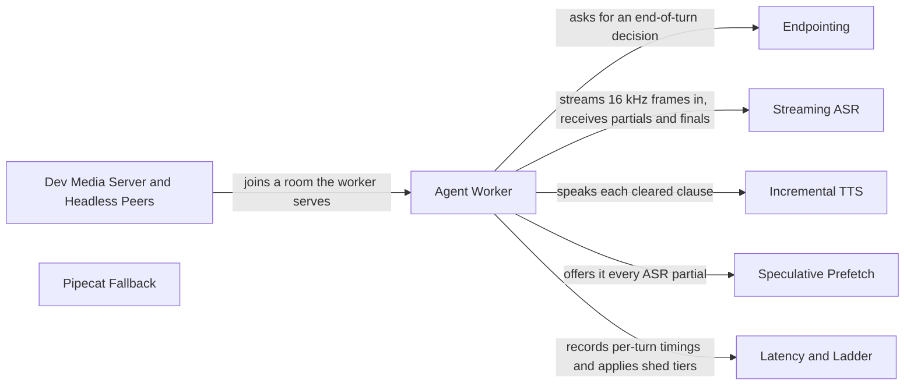

# LiveKit Voice Pipeline

[Back to the overview](overview.md) · component 3

## Details

The media path in production: an agent worker that joins the LiveKit room as a participant, with Silero VAD, context-dependent endpointing, streaming Amazon Transcribe, incremental Amazon Polly, speculative prefetch and a latency ladder. A Pipecat SmallWebRTC path is kept as a documented fallback.

### Relations

| From | To | Relation | Evidence |
|---|---|---|---|
| Agent Worker | Endpointing | asks for an end-of-turn decision | `server/livekit_agent.py:RoomVoiceAgent` |
| Agent Worker | Streaming ASR | streams 16 kHz frames in, receives partials and finals | `server/livekit_agent.py:RoomVoiceAgent` |
| Agent Worker | Incremental TTS | speaks each cleared clause | `server/livekit_agent.py:RoomVoiceAgent` |
| Agent Worker | Speculative Prefetch | offers it every ASR partial | `server/livekit_agent.py:RoomVoiceAgent` |
| Agent Worker | Latency and Ladder | records per-turn timings and applies shed tiers | `server/livekit_agent.py:RoomVoiceAgent` |
| Dev Media Server and Headless Peers | Agent Worker | joins a room the worker serves | `server/livekit_peer.py:HeadlessParticipant` |

### Agent Worker

`AgentWorker` runs the LiveKit worker; `entrypoint` joins a room; `RoomVoiceAgent` owns one room's audio loop, barge-in and turn dispatch.

**Related Classes/Methods**:

- [`server/livekit_agent.py`:`AgentWorker`](../../server/livekit_agent.py#L1350-L1425)

**Source Files:**

- [`server/livekit_agent.py`](../../server/livekit_agent.py)
  - `AgentWorker` ([L1350-L1425](../../server/livekit_agent.py#L1350-L1425)) - class
  - `RoomVoiceAgent` ([L313-L1318](../../server/livekit_agent.py#L313-L1318)) - class
  - `entrypoint` ([L1326-L1346](../../server/livekit_agent.py#L1326-L1346)) - function
  - `AgentHost` ([L152-L182](../../server/livekit_agent.py#L152-L182)) - class
  - `VoiceStats` ([L225-L237](../../server/livekit_agent.py#L225-L237)) - class

### Endpointing

Decides end-of-turn with a hangover chosen by FSM state rather than one global silence threshold.

**Related Classes/Methods**:

- [`server/endpointing.py`:`Endpointer`](../../server/endpointing.py#L341-L470)

**Source Files:**

- [`server/endpointing.py`](../../server/endpointing.py)
  - `Endpointer` ([L341-L470](../../server/endpointing.py#L341-L470)) - class
  - `classify_turn` ([L198-L243](../../server/endpointing.py#L198-L243)) - function
  - `Hangover` ([L74-L87](../../server/endpointing.py#L74-L87)) - class
  - `EndpointDecision` ([L328-L337](../../server/endpointing.py#L328-L337)) - class

### Streaming ASR

Amazon Transcribe Streaming with custom-vocabulary biasing; emits partials that the prefetch consumes.

**Related Classes/Methods**:

- [`server/transcribe.py`:`TranscribeStream`](../../server/transcribe.py#L349-L535)

**Source Files:**

- [`server/transcribe.py`](../../server/transcribe.py)
  - `TranscribeStream` ([L349-L535](../../server/transcribe.py#L349-L535)) - class
  - `ensure_vocabulary` ([L111-L159](../../server/transcribe.py#L111-L159)) - function
  - `alias_candidates` ([L271-L295](../../server/transcribe.py#L271-L295)) - function

### Incremental TTS

Amazon Polly Neural: whole-utterance synthesis with a disk cache, and clause-by-clause incremental synthesis.

**Related Classes/Methods**:

- [`server/polly.py`:`synthesize_incremental`](../../server/polly.py#L268-L366)

**Source Files:**

- [`server/polly.py`](../../server/polly.py)
  - `synthesize_incremental` ([L268-L366](../../server/polly.py#L268-L366)) - function
  - `synthesize_pcm` ([L67-L118](../../server/polly.py#L67-L118)) - function
  - `split_clauses` ([L223-L226](../../server/polly.py#L223-L226)) - function
  - `ClauseBuffer` ([L152-L220](../../server/polly.py#L152-L220)) - class

### Speculative Prefetch

On a category-bearing ASR partial of enough words, runs retrieval early and discards the result if the final transcript disagrees.

**Related Classes/Methods**:

- [`server/prefetch.py`:`SpeculativePrefetch`](../../server/prefetch.py#L298-L481)

**Source Files:**

- [`server/prefetch.py`](../../server/prefetch.py)
  - `SpeculativePrefetch` ([L298-L481](../../server/prefetch.py#L298-L481)) - class
  - `shortlist_for` ([L254-L276](../../server/prefetch.py#L254-L276)) - function
  - `category_bearing` ([L279-L290](../../server/prefetch.py#L279-L290)) - function

### Latency and Ladder

Measures the nine-component latency budget per turn and applies the graded degradation ladder on a measured breach.

**Related Classes/Methods**:

- [`server/latency.py`:`LatencyBook`](../../server/latency.py#L669-L799)
- [`server/ladder.py`:`Ladder`](../../server/ladder.py#L220-L408)

**Source Files:**

- [`server/latency.py`](../../server/latency.py)
  - `LatencyBook` ([L669-L799](../../server/latency.py#L669-L799)) - class
  - `TurnLatency` ([L274-L391](../../server/latency.py#L274-L391)) - class
  - `measure_core` ([L494-L511](../../server/latency.py#L494-L511)) - function
  - `summarise` ([L807-L833](../../server/latency.py#L807-L833)) - function
- [`server/ladder.py`](../../server/ladder.py)
  - `Ladder` ([L220-L408](../../server/ladder.py#L220-L408)) - class
  - `shed_for` ([L159-L172](../../server/ladder.py#L159-L172)) - function
  - `Shed` ([L112-L154](../../server/ladder.py#L112-L154)) - class

### Dev Media Server and Headless Peers

Runs `livekit-server --dev` locally, joins rooms without a browser, and verifies the voice path end to end (`python -m server.verify_livekit`).

**Related Classes/Methods**:

- [`server/livekit_dev.py`:`start_dev_server`](../../server/livekit_dev.py#L158-L172)
- [`server/livekit_peer.py`:`HeadlessParticipant`](../../server/livekit_peer.py#L89-L305)
- [`server/verify_livekit.py`:`run`](../../server/verify_livekit.py#L658-L679)

**Source Files:**

- [`server/livekit_dev.py`](../../server/livekit_dev.py)
  - `start_dev_server` ([L158-L172](../../server/livekit_dev.py#L158-L172)) - function
  - `DevServer` ([L77-L155](../../server/livekit_dev.py#L77-L155)) - class
  - `find_binary` ([L51-L59](../../server/livekit_dev.py#L51-L59)) - function
- [`server/livekit_peer.py`](../../server/livekit_peer.py)
  - `HeadlessParticipant` ([L89-L305](../../server/livekit_peer.py#L89-L305)) - class
  - `open_session` ([L308-L312](../../server/livekit_peer.py#L308-L312)) - function
- [`server/verify_livekit.py`](../../server/verify_livekit.py)
  - `run` ([L658-L679](../../server/verify_livekit.py#L658-L679)) - function
  - `verify_barge_in` ([L469-L610](../../server/verify_livekit.py#L469-L610)) - function

### Pipecat Fallback

The Pipecat SmallWebRTC peer connection inside the server process (`/api/offer`), its headless test peer, and the ICE-candidate rewrite for hosts behind 1:1 NAT.

**Related Classes/Methods**:

- [`server/pipeline.py`:`attach_media`](../../server/pipeline.py#L430-L439)
- [`server/headless_peer.py`:`HeadlessPeer`](../../server/headless_peer.py#L149-L263)
- [`server/sdp.py`:`rewrite_host_candidates`](../../server/sdp.py#L35-L67)

**Source Files:**

- [`server/pipeline.py`](../../server/pipeline.py)
  - `attach_media` ([L430-L439](../../server/pipeline.py#L430-L439)) - function
  - `MediaSession` ([L223-L427](../../server/pipeline.py#L223-L427)) - class
  - `SpeechReporter` ([L102-L220](../../server/pipeline.py#L102-L220)) - class
- [`server/headless_peer.py`](../../server/headless_peer.py)
  - `HeadlessPeer` ([L149-L263](../../server/headless_peer.py#L149-L263)) - class
  - `open_session` ([L266-L270](../../server/headless_peer.py#L266-L270)) - function
- [`server/sdp.py`](../../server/sdp.py)
  - `rewrite_host_candidates` ([L35-L67](../../server/sdp.py#L35-L67)) - function
