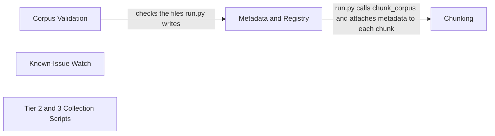

# RAG Corpus and Ingest

[Back to the overview](overview.md) · component 6

## Details

The offline path that builds the Tier-1 corpus: `python -m ingest.run` chunks the saved manuals and help-center pages under `data/raw/` and `data/text/`, attaches metadata and the source registry, and writes `data/processed/chunks.jsonl` and `data/processed/sources.json`. `agent.store.migrate` loads those into Postgres. Tier-2 and Tier-3 collection scripts live in `scripts/` and never feed the speech path.

### Relations

| From | To | Relation | Evidence |
|---|---|---|---|
| Metadata and Registry | Chunking | run.py calls chunk_corpus and attaches metadata to each chunk | `ingest/run.py:main` |
| Corpus Validation | Metadata and Registry | checks the files run.py writes | `ingest/validate.py:check_chunks` |

### Chunking

Parses HTML and manual text and packs chunks; a procedure is never split.

**Related Classes/Methods**:

- [`ingest/chunk.py`:`chunk_corpus`](../../ingest/chunk.py#L928-L933)

**Source Files:**

- [`ingest/chunk.py`](../../ingest/chunk.py)
  - `chunk_corpus` ([L928-L933](../../ingest/chunk.py#L928-L933)) - function
  - `chunk_source` ([L868-L925](../../ingest/chunk.py#L868-L925)) - function
  - `parse_html` ([L273-L299](../../ingest/chunk.py#L273-L299)) - function
  - `parse_manual` ([L532-L601](../../ingest/chunk.py#L532-L601)) - function
  - `pack` ([L805-L825](../../ingest/chunk.py#L805-L825)) - function

### Metadata and Registry

Declared (not inferred) model applicability, clearance flags and the source registry; `run.py` writes both output files.

**Related Classes/Methods**:

- [`ingest/metadata.py`:`build_metadata`](../../ingest/metadata.py#L1388-L1503)
- [`ingest/run.py`:`main`](../../ingest/run.py#L156-L163)

**Source Files:**

- [`ingest/metadata.py`](../../ingest/metadata.py)
  - `build_metadata` ([L1388-L1503](../../ingest/metadata.py#L1388-L1503)) - function
  - `Source` ([L155-L183](../../ingest/metadata.py#L155-L183)) - class
  - `Chunk` ([L1283-L1323](../../ingest/metadata.py#L1283-L1323)) - class
  - `redact_firmware_versions` ([L1234-L1268](../../ingest/metadata.py#L1234-L1268)) - function
- [`ingest/run.py`](../../ingest/run.py)
  - `main` ([L156-L163](../../ingest/run.py#L156-L163)) - function
  - `build_registry` ([L31-L82](../../ingest/run.py#L31-L82)) - function
  - `write_outputs` ([L85-L93](../../ingest/run.py#L85-L93)) - function

### Corpus Validation

`python -m ingest.validate` checks the corpus against the design rules; breaches exit non-zero.

**Related Classes/Methods**:

- [`ingest/validate.py`:`check_chunks`](../../ingest/validate.py#L96-L179)

**Source Files:**

- [`ingest/validate.py`](../../ingest/validate.py)
  - `check_chunks` ([L96-L179](../../ingest/validate.py#L96-L179)) - function
  - `check_procedures_atomic` ([L182-L210](../../ingest/validate.py#L182-L210)) - function
  - `check_step_ids` ([L228-L247](../../ingest/validate.py#L228-L247)) - function
  - `main` ([L303-L346](../../ingest/validate.py#L303-L346)) - function

### Known-Issue Watch

A watcher over public pages whose output is asserted to be Tier 2; it is not a vendor feed and is never speakable.

**Related Classes/Methods**:

- [`ingest/known_issues.py`:`assert_monitor_output_is_tier2`](../../ingest/known_issues.py#L314-L342)

**Source Files:**

- [`ingest/known_issues.py`](../../ingest/known_issues.py)
  - `assert_monitor_output_is_tier2` ([L314-L342](../../ingest/known_issues.py#L314-L342)) - function
  - `KnownIssueRecord` ([L222-L311](../../ingest/known_issues.py#L222-L311)) - class
  - `confirm_with_tier1` ([L345-L383](../../ingest/known_issues.py#L345-L383)) - function
  - `WatchedPage` ([L157-L162](../../ingest/known_issues.py#L157-L162)) - class

### Tier 2 and 3 Collection Scripts

Scripts for discovery-only samples (app-store reviews) and for reading saved pages; their output is never a verified fix.

**Source Files:**

- [`scripts/collect_app_reviews.py`](../../scripts/collect_app_reviews.py)
- [`scripts/html2txt.py`](../../scripts/html2txt.py)
- [`scripts/probe_amazon_aggregators.py`](../../scripts/probe_amazon_aggregators.py)
- [`scripts/probe_amazon_round2.py`](../../scripts/probe_amazon_round2.py)
- [`scripts/probe_play.py`](../../scripts/probe_play.py)
