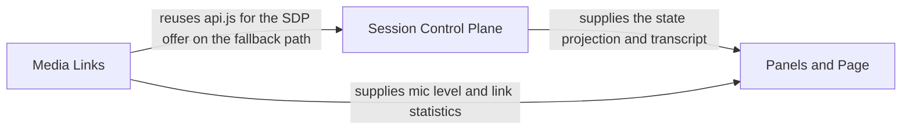

# React Client

[Back to the overview](overview.md) · component 1

## Details

The browser page (Vite + React 18, `livekit-client` as the only runtime dependency besides React). It renders a projection of the server's diagnostic state in four panels and offers click-or-type next to the voice channel. It never owns state: a reload loses nothing.

### Relations

| From | To | Relation | Evidence |
|---|---|---|---|
| Session Control Plane | Panels and Page | supplies the state projection and transcript | `client/src/App.jsx:useSession` |
| Media Links | Panels and Page | supplies mic level and link statistics | `client/src/App.jsx:LiveKitLink` |
| Media Links | Session Control Plane | reuses api.js for the SDP offer on the fallback path | `client/src/webrtc.js:postOffer` |

### Session Control Plane

One WebSocket plus the REST calls that start it. `api.js` mints the session and renews the token; `useSession` holds the state projection the panels render from.

**Related Classes/Methods**:

- [`client/src/useSession.js`:`useSession`](../../client/src/useSession.js#L26-L26)
- [`client/src/api.js`:`openSession`](../../client/src/api.js#L9-L9)

**Source Files:**

- [`client/src/useSession.js`](../../client/src/useSession.js)
  - `useSession` ([L26-L26](../../client/src/useSession.js#L26-L26)) - reference
- [`client/src/api.js`](../../client/src/api.js)
  - `openSession` ([L9-L9](../../client/src/api.js#L9-L9)) - reference
  - `renewToken` ([L24-L24](../../client/src/api.js#L24-L24)) - reference
  - `controlSocketUrl` ([L64-L64](../../client/src/api.js#L64-L64)) - reference
  - `postOffer` ([L35-L35](../../client/src/api.js#L35-L35)) - reference
  - `postCandidates` ([L55-L55](../../client/src/api.js#L55-L55)) - reference
- [`client/src/main.jsx`](../../client/src/main.jsx)

### Media Links

The two media legs. `LiveKitLink` joins a LiveKit room with the minted token (the default transport); `MediaLink` is the Pipecat SmallWebRTC fallback. `summariseStats` turns browser `getStats()` into the RTT, jitter and loss numbers the page shows and the trace records.

**Related Classes/Methods**:

- [`client/src/livekit.js`:`LiveKitLink`](../../client/src/livekit.js#L57-L57)
- [`client/src/webrtc.js`:`MediaLink`](../../client/src/webrtc.js#L30-L30)
- [`client/src/stats.js`:`summariseStats`](../../client/src/stats.js#L14-L14)

**Source Files:**

- [`client/src/livekit.js`](../../client/src/livekit.js)
  - `LiveKitLink` ([L57-L57](../../client/src/livekit.js#L57-L57)) - reference
- [`client/src/webrtc.js`](../../client/src/webrtc.js)
  - `MediaLink` ([L30-L30](../../client/src/webrtc.js#L30-L30)) - reference
  - `microphoneAvailable` ([L206-L206](../../client/src/webrtc.js#L206-L206)) - reference
- [`client/src/stats.js`](../../client/src/stats.js)
  - `summariseStats` ([L14-L14](../../client/src/stats.js#L14-L14)) - reference

### Panels and Page

`App` lays out transcript, current step, diagnostic state and connection bar. Each panel is a small component; `Composer` is the click-or-type input and `EventLog` shows the live trace.

**Related Classes/Methods**:

- [`client/src/App.jsx`:`App`](../../client/src/App.jsx#L44-L44)
- [`client/src/components/Transcript.jsx`:`Transcript`](../../client/src/components/Transcript.jsx#L32-L32)
- [`client/src/components/StepPanel.jsx`:`StepPanel`](../../client/src/components/StepPanel.jsx#L18-L18)

**Source Files:**

- [`client/src/App.jsx`](../../client/src/App.jsx)
  - `App` ([L44-L44](../../client/src/App.jsx#L44-L44)) - reference
- [`client/src/components/Transcript.jsx`](../../client/src/components/Transcript.jsx)
  - `Transcript` ([L32-L32](../../client/src/components/Transcript.jsx#L32-L32)) - reference
- [`client/src/components/StepPanel.jsx`](../../client/src/components/StepPanel.jsx)
  - `StepPanel` ([L18-L18](../../client/src/components/StepPanel.jsx#L18-L18)) - reference
- [`client/src/components/StatePanel.jsx`](../../client/src/components/StatePanel.jsx)
  - `StatePanel` ([L22-L22](../../client/src/components/StatePanel.jsx#L22-L22)) - reference
- [`client/src/components/Composer.jsx`](../../client/src/components/Composer.jsx)
  - `Composer` ([L25-L25](../../client/src/components/Composer.jsx#L25-L25)) - reference
- [`client/src/components/ConnectionBar.jsx`](../../client/src/components/ConnectionBar.jsx)
  - `ConnectionBar` ([L63-L63](../../client/src/components/ConnectionBar.jsx#L63-L63)) - reference
- [`client/src/components/LevelMeter.jsx`](../../client/src/components/LevelMeter.jsx)
  - `LevelMeter` ([L18-L18](../../client/src/components/LevelMeter.jsx#L18-L18)) - reference
- [`client/src/components/EventLog.jsx`](../../client/src/components/EventLog.jsx)
  - `EventLog` ([L63-L63](../../client/src/components/EventLog.jsx#L63-L63)) - reference
- [`client/src/components/Doodles.jsx`](../../client/src/components/Doodles.jsx)
  - `Mascot` ([L51-L51](../../client/src/components/Doodles.jsx#L51-L51)) - reference
- [`client/src/styles.css`](../../client/src/styles.css)
