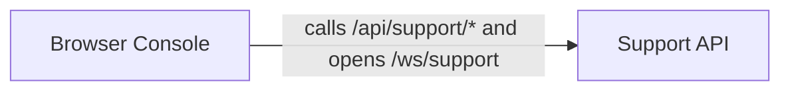

# Support Console

[Back to the overview](overview.md) · component 9

## Details

The human side of escalation. A no-framework browser console (`support/`, built with `node support/build.mjs`) and the server routes it calls (`/api/support/*`, `/ws/support`): observer tokens, a room list, the handoff panel, disclosure, joining the same room, and collecting a consented transcript.

### Relations

| From | To | Relation | Evidence |
|---|---|---|---|
| Browser Console | Support API | calls /api/support/* and opens /ws/support | `server/support.py:register_support_routes` |

### Support API

`register_support_routes` adds the observer, rooms, handoff, trace, disclose, join, leave and collect routes plus `/ws/support`.

**Related Classes/Methods**:

- [`server/support.py`:`register_support_routes`](../../server/support.py#L189-L532)

**Source Files:**

- [`server/support.py`](../../server/support.py)
  - `register_support_routes` ([L189-L532](../../server/support.py#L189-L532)) - function
  - `authorise_observer` ([L102-L149](../../server/support.py#L102-L149)) - function
  - `check_support_key` ([L87-L99](../../server/support.py#L87-L99)) - function
  - `room_summary` ([L152-L181](../../server/support.py#L152-L181)) - function

### Browser Console

Pure panel renderers (`panels.js`), the DOM and network layer (`main.js`), the REST and WebSocket clients, a stdlib-only build and a self-test.

**Source Files:**

- [`support/src/main.js`](../../support/src/main.js)
- [`support/src/panels.js`](../../support/src/panels.js)
- [`support/src/api.js`](../../support/src/api.js)
- [`support/src/socket.js`](../../support/src/socket.js)
- [`support/src/console.css`](../../support/src/console.css)
- [`support/index.html`](../../support/index.html)
- [`support/build.mjs`](../../support/build.mjs)
- [`support/selftest.mjs`](../../support/selftest.mjs)
