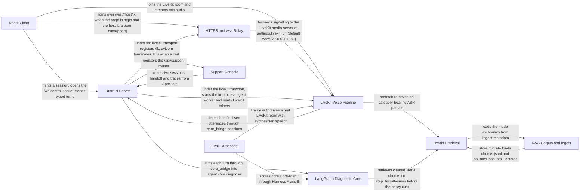

# Rove architecture (CodeBoarding format)

> Hand-authored in CodeBoarding's output format, not produced by the engine. [README.md](README.md) says why and what was cross-checked against docs 06 and 08.

## Details

Rove is a voice troubleshooting agent for a consumer dash-cam line. A React page joins a LiveKit room; a Python agent worker in the FastAPI process hears the caller (Amazon Transcribe), decides when the turn has ended, and speaks (Amazon Polly). Every turn runs through a LangGraph state machine that retrieves Tier-1 chunks from Postgres plus pgvector, filters the legal next steps in code, lets a Bedrock Nova model choose among them, and passes the result through a deterministic output guard. The corpus is built offline by ingest/, the whole system is scored by three eval harnesses, an https page reaches the media server through a same-origin wss relay, and a separate support console can join a live session.

### Relations

| From | To | Relation | Evidence |
|---|---|---|---|
| React Client | FastAPI Server | mints a session, opens the /ws control socket, sends typed turns | `client/src/api.js:openSession` `server/app.py:create_app` |
| React Client | LiveKit Voice Pipeline | joins the LiveKit room and streams mic audio | `client/src/livekit.js:LiveKitLink` `server/livekit_agent.py:AgentWorker` |
| React Client | HTTPS and wss Relay | joins over wss://host/lk when the page is https and the host is a bare name[:port] | `server/config.py:Settings.livekit_public_url` `server/livekit_relay.py:register_livekit_relay` |
| HTTPS and wss Relay | LiveKit Voice Pipeline | forwards signalling to the LiveKit media server at settings.livekit_url (default ws://127.0.0.1:7880) | `server/livekit_relay.py:register_livekit_relay` `server/config.py:Settings` |
| FastAPI Server | HTTPS and wss Relay | under the livekit transport registers /lk; uvicorn terminates TLS when a cert and key are set | `server/app.py:create_app` `server/__main__.py:main` |
| FastAPI Server | LiveKit Voice Pipeline | under the livekit transport, starts the in-process agent worker and mints LiveKit tokens | `server/livekit_agent.py:AgentWorker` `server/livekit_tokens.py:mint` |
| FastAPI Server | LangGraph Diagnostic Core | runs each turn through core_bridge into agent.core.diagnose | `server/core_bridge.py:run_typed_turn` `agent/core.py:diagnose` |
| LiveKit Voice Pipeline | FastAPI Server | dispatches finalised utterances through core_bridge sessions | `server/livekit_agent.py:RoomVoiceAgent` `server/core_bridge.py:Session` |
| LiveKit Voice Pipeline | Hybrid Retrieval | prefetch retrieves on category-bearing ASR partials | `server/prefetch.py:SpeculativePrefetch` `agent/retrieval.py:retrieve` |
| LangGraph Diagnostic Core | Hybrid Retrieval | retrieves cleared Tier-1 chunks (in step_hypothesise) before the policy runs | `agent/core.py:step_hypothesise` `agent/retrieval.py:retrieve` |
| RAG Corpus and Ingest | Hybrid Retrieval | store.migrate loads chunks.jsonl and sources.json into Postgres | `agent/store.py:migrate` `ingest/run.py:write_outputs` |
| Hybrid Retrieval | RAG Corpus and Ingest | reads the model vocabulary from ingest.metadata | `agent/retrieval.py:model_filter` `ingest/metadata.py:build_metadata` |
| Eval Harnesses | LangGraph Diagnostic Core | scores core.CoreAgent through Harness A and B | `eval/harness.py:build_agent` `agent/core.py:CoreAgent` |
| Eval Harnesses | LiveKit Voice Pipeline | Harness C drives a real LiveKit room with synthesised speech | `eval/harness_c.py:run_case` `server/livekit_peer.py:open_session` |
| FastAPI Server | Support Console | registers the /api/support routes | `server/app.py:create_app` `server/support.py:register_support_routes` |
| Support Console | FastAPI Server | reads live sessions, handoff and traces from AppState | `server/support.py:room_summary` `server/app.py:AppState` |

### React Client

The browser page (Vite + React 18, `livekit-client` as the only runtime dependency besides React). It renders a projection of the server's diagnostic state in four panels and offers click-or-type next to the voice channel. It never owns state: a reload loses nothing.

**Related Classes/Methods**:

- [`client/src/useSession.js`:`useSession`](../../client/src/useSession.js#L26-L26)
- [`client/src/api.js`:`openSession`](../../client/src/api.js#L9-L9)
- [`client/src/livekit.js`:`LiveKitLink`](../../client/src/livekit.js#L57-L57)

**Source Files:**

- [`client/src/useSession.js`](../../client/src/useSession.js)
  - `useSession` ([L26-L26](../../client/src/useSession.js#L26-L26)) - reference
- [`client/src/api.js`](../../client/src/api.js)
  - `openSession` ([L9-L9](../../client/src/api.js#L9-L9)) - reference
  - `renewToken` ([L24-L24](../../client/src/api.js#L24-L24)) - reference
  - `controlSocketUrl` ([L64-L64](../../client/src/api.js#L64-L64)) - reference
  - `postOffer` ([L35-L35](../../client/src/api.js#L35-L35)) - reference
  - `postCandidates` ([L55-L55](../../client/src/api.js#L55-L55)) - reference
- [`client/src/main.jsx`](../../client/src/main.jsx)
- [`client/src/livekit.js`](../../client/src/livekit.js)
  - `LiveKitLink` ([L57-L57](../../client/src/livekit.js#L57-L57)) - reference
- [`client/src/webrtc.js`](../../client/src/webrtc.js)
  - `MediaLink` ([L30-L30](../../client/src/webrtc.js#L30-L30)) - reference
  - `microphoneAvailable` ([L206-L206](../../client/src/webrtc.js#L206-L206)) - reference
- [`client/src/stats.js`](../../client/src/stats.js)
  - `summariseStats` ([L14-L14](../../client/src/stats.js#L14-L14)) - reference
- [`client/src/App.jsx`](../../client/src/App.jsx)
  - `App` ([L44-L44](../../client/src/App.jsx#L44-L44)) - reference
- [`client/src/components/Transcript.jsx`](../../client/src/components/Transcript.jsx)
  - `Transcript` ([L32-L32](../../client/src/components/Transcript.jsx#L32-L32)) - reference
- [`client/src/components/StepPanel.jsx`](../../client/src/components/StepPanel.jsx)
  - `StepPanel` ([L18-L18](../../client/src/components/StepPanel.jsx#L18-L18)) - reference
- [`client/src/components/StatePanel.jsx`](../../client/src/components/StatePanel.jsx)
  - `StatePanel` ([L22-L22](../../client/src/components/StatePanel.jsx#L22-L22)) - reference
- [`client/src/components/Composer.jsx`](../../client/src/components/Composer.jsx)
  - `Composer` ([L25-L25](../../client/src/components/Composer.jsx#L25-L25)) - reference
- [`client/src/components/ConnectionBar.jsx`](../../client/src/components/ConnectionBar.jsx)
  - `ConnectionBar` ([L63-L63](../../client/src/components/ConnectionBar.jsx#L63-L63)) - reference
- [`client/src/components/LevelMeter.jsx`](../../client/src/components/LevelMeter.jsx)
  - `LevelMeter` ([L18-L18](../../client/src/components/LevelMeter.jsx#L18-L18)) - reference
- [`client/src/components/EventLog.jsx`](../../client/src/components/EventLog.jsx)
  - `EventLog` ([L63-L63](../../client/src/components/EventLog.jsx#L63-L63)) - reference
- [`client/src/components/Doodles.jsx`](../../client/src/components/Doodles.jsx)
  - `Mascot` ([L51-L51](../../client/src/components/Doodles.jsx#L51-L51)) - reference
- [`client/src/styles.css`](../../client/src/styles.css)
[Expand: nested diagram](React_Client.md)

### FastAPI Server

One FastAPI process on one port. It mints short-lived session credentials, serves the built client, owns the control WebSocket, runs every typed turn against the diagnostic core, and holds consent, handoff, trace and transcript records. In the default transport it does not carry media.

**Related Classes/Methods**:

- [`server/app.py`:`create_app`](../../server/app.py#L486-L797)
- [`server/config.py`:`Settings`](../../server/config.py#L101-L279)
- [`server/__main__.py`:`main`](../../server/__main__.py#L26-L113)

**Source Files:**

- [`server/app.py`](../../server/app.py)
  - `create_app` ([L486-L797](../../server/app.py#L486-L797)) - function
  - `AppState` ([L89-L384](../../server/app.py#L89-L384)) - class
  - `run_turn` ([L398-L483](../../server/app.py#L398-L483)) - function
  - `broadcast` ([L387-L395](../../server/app.py#L387-L395)) - function
- [`server/config.py`](../../server/config.py)
  - `Settings` ([L101-L279](../../server/config.py#L101-L279)) - class
- [`server/__main__.py`](../../server/__main__.py)
  - `main` ([L26-L113](../../server/__main__.py#L26-L113)) - function
- [`server/livekit_tokens.py`](../../server/livekit_tokens.py)
  - `mint` ([L87-L148](../../server/livekit_tokens.py#L87-L148)) - function
  - `verify` ([L151-L230](../../server/livekit_tokens.py#L151-L230)) - function
  - `Claims` ([L69-L84](../../server/livekit_tokens.py#L69-L84)) - class
- [`server/tokens.py`](../../server/tokens.py)
  - `mint` ([L225-L276](../../server/tokens.py#L225-L276)) - function
  - `verify` ([L279-L364](../../server/tokens.py#L279-L364)) - function
  - `MintedSession` ([L382-L415](../../server/tokens.py#L382-L415)) - class
  - `new_room_id` ([L418-L420](../../server/tokens.py#L418-L420)) - function
- [`server/core_bridge.py`](../../server/core_bridge.py)
  - `Session` ([L126-L226](../../server/core_bridge.py#L126-L226)) - class
  - `SessionRegistry` ([L229-L267](../../server/core_bridge.py#L229-L267)) - class
  - `run_typed_turn` ([L275-L427](../../server/core_bridge.py#L275-L427)) - function
  - `fanout` ([L517-L544](../../server/core_bridge.py#L517-L544)) - function
  - `project_state` ([L570-L630](../../server/core_bridge.py#L570-L630)) - function
  - `session_snapshot` ([L654-L679](../../server/core_bridge.py#L654-L679)) - function
- [`server/consent.py`](../../server/consent.py)
  - `ConsentState` ([L101-L314](../../server/consent.py#L101-L314)) - class
- [`server/handoff.py`](../../server/handoff.py)
  - `build_handoff` ([L366-L466](../../server/handoff.py#L366-L466)) - function
- [`server/trace.py`](../../server/trace.py)
  - `Trace` ([L36-L136](../../server/trace.py#L36-L136)) - class
- [`server/transcripts.py`](../../server/transcripts.py)
  - `collect` ([L282-L416](../../server/transcripts.py#L282-L416)) - function
  - `check_consent` ([L267-L279](../../server/transcripts.py#L267-L279)) - function
  - `redact` ([L170-L183](../../server/transcripts.py#L170-L183)) - function
- [`server/verify.py`](../../server/verify.py)
  - `run` ([L386-L398](../../server/verify.py#L386-L398)) - function
  - `BackgroundServer` ([L62-L115](../../server/verify.py#L62-L115)) - class
  - `verify_mint` ([L163-L247](../../server/verify.py#L163-L247)) - function
[Expand: nested diagram](FastAPI_Server.md)

### LiveKit Voice Pipeline

The media path in production: an agent worker that joins the LiveKit room as a participant, with Silero VAD, context-dependent endpointing, streaming Amazon Transcribe, incremental Amazon Polly, speculative prefetch and a latency ladder. A Pipecat SmallWebRTC path is kept as a documented fallback.

**Related Classes/Methods**:

- [`server/livekit_agent.py`:`AgentWorker`](../../server/livekit_agent.py#L1350-L1425)
- [`server/endpointing.py`:`Endpointer`](../../server/endpointing.py#L341-L470)
- [`server/transcribe.py`:`TranscribeStream`](../../server/transcribe.py#L349-L535)

**Source Files:**

- [`server/livekit_agent.py`](../../server/livekit_agent.py)
  - `AgentWorker` ([L1350-L1425](../../server/livekit_agent.py#L1350-L1425)) - class
  - `RoomVoiceAgent` ([L313-L1318](../../server/livekit_agent.py#L313-L1318)) - class
  - `entrypoint` ([L1326-L1346](../../server/livekit_agent.py#L1326-L1346)) - function
  - `AgentHost` ([L152-L182](../../server/livekit_agent.py#L152-L182)) - class
  - `VoiceStats` ([L225-L237](../../server/livekit_agent.py#L225-L237)) - class
- [`server/endpointing.py`](../../server/endpointing.py)
  - `Endpointer` ([L341-L470](../../server/endpointing.py#L341-L470)) - class
  - `classify_turn` ([L198-L243](../../server/endpointing.py#L198-L243)) - function
  - `Hangover` ([L74-L87](../../server/endpointing.py#L74-L87)) - class
  - `EndpointDecision` ([L328-L337](../../server/endpointing.py#L328-L337)) - class
- [`server/transcribe.py`](../../server/transcribe.py)
  - `TranscribeStream` ([L349-L535](../../server/transcribe.py#L349-L535)) - class
  - `ensure_vocabulary` ([L111-L159](../../server/transcribe.py#L111-L159)) - function
  - `alias_candidates` ([L271-L295](../../server/transcribe.py#L271-L295)) - function
- [`server/polly.py`](../../server/polly.py)
  - `synthesize_incremental` ([L268-L366](../../server/polly.py#L268-L366)) - function
  - `synthesize_pcm` ([L67-L118](../../server/polly.py#L67-L118)) - function
  - `split_clauses` ([L223-L226](../../server/polly.py#L223-L226)) - function
  - `ClauseBuffer` ([L152-L220](../../server/polly.py#L152-L220)) - class
- [`server/prefetch.py`](../../server/prefetch.py)
  - `SpeculativePrefetch` ([L298-L481](../../server/prefetch.py#L298-L481)) - class
  - `shortlist_for` ([L254-L276](../../server/prefetch.py#L254-L276)) - function
  - `category_bearing` ([L279-L290](../../server/prefetch.py#L279-L290)) - function
- [`server/latency.py`](../../server/latency.py)
  - `LatencyBook` ([L669-L799](../../server/latency.py#L669-L799)) - class
  - `TurnLatency` ([L274-L391](../../server/latency.py#L274-L391)) - class
  - `measure_core` ([L494-L511](../../server/latency.py#L494-L511)) - function
  - `summarise` ([L807-L833](../../server/latency.py#L807-L833)) - function
- [`server/ladder.py`](../../server/ladder.py)
  - `Ladder` ([L220-L408](../../server/ladder.py#L220-L408)) - class
  - `shed_for` ([L159-L172](../../server/ladder.py#L159-L172)) - function
  - `Shed` ([L112-L154](../../server/ladder.py#L112-L154)) - class
- [`server/livekit_dev.py`](../../server/livekit_dev.py)
  - `start_dev_server` ([L158-L172](../../server/livekit_dev.py#L158-L172)) - function
  - `DevServer` ([L77-L155](../../server/livekit_dev.py#L77-L155)) - class
  - `find_binary` ([L51-L59](../../server/livekit_dev.py#L51-L59)) - function
- [`server/livekit_peer.py`](../../server/livekit_peer.py)
  - `HeadlessParticipant` ([L89-L305](../../server/livekit_peer.py#L89-L305)) - class
  - `open_session` ([L308-L312](../../server/livekit_peer.py#L308-L312)) - function
- [`server/verify_livekit.py`](../../server/verify_livekit.py)
  - `run` ([L658-L679](../../server/verify_livekit.py#L658-L679)) - function
  - `verify_barge_in` ([L469-L610](../../server/verify_livekit.py#L469-L610)) - function
- [`server/pipeline.py`](../../server/pipeline.py)
  - `attach_media` ([L430-L439](../../server/pipeline.py#L430-L439)) - function
  - `MediaSession` ([L223-L427](../../server/pipeline.py#L223-L427)) - class
  - `SpeechReporter` ([L102-L220](../../server/pipeline.py#L102-L220)) - class
- [`server/headless_peer.py`](../../server/headless_peer.py)
  - `HeadlessPeer` ([L149-L263](../../server/headless_peer.py#L149-L263)) - class
  - `open_session` ([L266-L270](../../server/headless_peer.py#L266-L270)) - function
- [`server/sdp.py`](../../server/sdp.py)
  - `rewrite_host_candidates` ([L35-L67](../../server/sdp.py#L35-L67)) - function
[Expand: nested diagram](LiveKit_Voice_Pipeline.md)

### LangGraph Diagnostic Core

The `agent` package: a typed `DiagnosticState`, a LangGraph `StateGraph` whose nodes are authored step functions, a next-step policy that removes illegal moves before the model sees a candidate list, a Bedrock Nova wrapper, and a deterministic output guard. `core.diagnose(utterance, state)` is the entry point.

**Related Classes/Methods**:

- [`agent/state.py`:`DiagnosticState`](../../agent/state.py#L773-L997)
- [`agent/graph.py`:`build_graph`](../../agent/graph.py#L375-L387)
- [`agent/core.py`:`diagnose`](../../agent/core.py#L1248-L1273)

**Source Files:**

- [`agent/state.py`](../../agent/state.py)
  - `DiagnosticState` ([L773-L997](../../agent/state.py#L773-L997)) - class
  - `State` ([L66-L87](../../agent/state.py#L66-L87)) - class
  - `Interrupt` ([L124-L135](../../agent/state.py#L124-L135)) - class
  - `Ledger` ([L638-L673](../../agent/state.py#L638-L673)) - class
  - `DeviceIdentification` ([L429-L545](../../agent/state.py#L429-L545)) - class
- [`agent/graph.py`](../../agent/graph.py)
  - `build_graph` ([L375-L387](../../agent/graph.py#L375-L387)) - function
  - `run_turn` ([L473-L504](../../agent/graph.py#L473-L504)) - function
  - `resume_turn` ([L507-L542](../../agent/graph.py#L507-L542)) - function
  - `make_checkpointer` ([L414-L424](../../agent/graph.py#L414-L424)) - function
  - `route_triage` ([L231-L233](../../agent/graph.py#L231-L233)) - function
- [`agent/core.py`](../../agent/core.py)
  - `diagnose` ([L1248-L1273](../../agent/core.py#L1248-L1273)) - function
  - `output_guard` ([L277-L315](../../agent/core.py#L277-L315)) - function
  - `step_triage` ([L586-L660](../../agent/core.py#L586-L660)) - function
  - `step_select_step` ([L746-L1016](../../agent/core.py#L746-L1016)) - function
  - `step_destructive_gate` ([L1025-L1049](../../agent/core.py#L1025-L1049)) - function
  - `CoreAgent` ([L1671-L1707](../../agent/core.py#L1671-L1707)) - class
  - `TurnResult` ([L448-L468](../../agent/core.py#L448-L468)) - class
- [`agent/policy.py`](../../agent/policy.py)
  - `candidate_steps` ([L116-L248](../../agent/policy.py#L116-L248)) - function
  - `select` ([L355-L373](../../agent/policy.py#L355-L373)) - function
  - `escalation` ([L405-L554](../../agent/policy.py#L405-L554)) - function
  - `legal_step_ids` ([L291-L292](../../agent/policy.py#L291-L292)) - function
  - `CandidateDecision` ([L95-L113](../../agent/policy.py#L95-L113)) - class
- [`agent/answers.py`](../../agent/answers.py)
  - `read_answer` ([L753-L768](../../agent/answers.py#L753-L768)) - function
  - `validate_rules` ([L851-L916](../../agent/answers.py#L851-L916)) - function
  - `AnswerRule` ([L110-L137](../../agent/answers.py#L110-L137)) - class
- [`agent/symptoms.py`](../../agent/symptoms.py)
  - `assess` ([L530-L580](../../agent/symptoms.py#L530-L580)) - function
  - `is_nearest_category_force` ([L483-L504](../../agent/symptoms.py#L483-L504)) - function
  - `Coverage` ([L513-L527](../../agent/symptoms.py#L513-L527)) - class
- [`agent/llm.py`](../../agent/llm.py)
  - `BedrockLLM` ([L311-L462](../../agent/llm.py#L311-L462)) - class
  - `NullLLM` ([L518-L532](../../agent/llm.py#L518-L532)) - class
  - `LLM` ([L84-L96](../../agent/llm.py#L84-L96)) - class
  - `parse_json_object` ([L104-L147](../../agent/llm.py#L104-L147)) - function
  - `Classification` ([L61-L68](../../agent/llm.py#L61-L68)) - class
  - `TurnDecision` ([L72-L81](../../agent/llm.py#L72-L81)) - class
- [`eval/ontology.py`](../../eval/ontology.py)
  - `legal_candidates` ([L1067-L1101](../../eval/ontology.py#L1067-L1101)) - function
  - `validate` ([L1113-L1136](../../eval/ontology.py#L1113-L1136)) - function
  - `AttemptedStep` ([L1002-L1040](../../eval/ontology.py#L1002-L1040)) - class
  - `Step` ([L169-L188](../../eval/ontology.py#L169-L188)) - class
  - `Family` ([L45-L50](../../eval/ontology.py#L45-L50)) - class
[Expand: nested diagram](LangGraph_Diagnostic_Core.md)

### Hybrid Retrieval

Filter first, then search. `retrieval.retrieve` applies model, category and speakable filters, fuses BM25 and dense scores, reranks and returns the top three Tier-1 chunks. The chunk store is Postgres plus pgvector (Titan embeddings); a JSONL backend takes over when Postgres does not answer.

**Related Classes/Methods**:

- [`agent/retrieval.py`:`retrieve`](../../agent/retrieval.py#L565-L655)
- [`agent/store.py`:`connect`](../../agent/store.py#L112-L132)

**Source Files:**

- [`agent/retrieval.py`](../../agent/retrieval.py)
  - `retrieve` ([L565-L655](../../agent/retrieval.py#L565-L655)) - function
  - `rerank` ([L523-L557](../../agent/retrieval.py#L523-L557)) - function
  - `model_filter` ([L189-L219](../../agent/retrieval.py#L189-L219)) - function
  - `Chunk` ([L105-L134](../../agent/retrieval.py#L105-L134)) - class
  - `RetrievalResult` ([L497-L520](../../agent/retrieval.py#L497-L520)) - class
  - `Hit` ([L484-L493](../../agent/retrieval.py#L484-L493)) - class
  - `Backend` ([L227-L246](../../agent/retrieval.py#L227-L246)) - class
  - `PostgresBackend` ([L249-L288](../../agent/retrieval.py#L249-L288)) - class
  - `JsonlBackend` ([L291-L340](../../agent/retrieval.py#L291-L340)) - class
  - `default_backend` ([L415-L422](../../agent/retrieval.py#L415-L422)) - function
- [`agent/store.py`](../../agent/store.py)
  - `connect` ([L112-L132](../../agent/store.py#L112-L132)) - function
  - `migrate` ([L449-L623](../../agent/store.py#L449-L623)) - function
  - `embed` ([L216-L243](../../agent/store.py#L216-L243)) - function
  - `embed_query` ([L246-L271](../../agent/store.py#L246-L271)) - function
  - `bm25_scores` ([L717-L734](../../agent/store.py#L717-L734)) - function
  - `dense_scores` ([L737-L749](../../agent/store.py#L737-L749)) - function
  - `fetch_chunk_rows` ([L649-L654](../../agent/store.py#L649-L654)) - function
  - `model_predicate` ([L657-L671](../../agent/store.py#L657-L671)) - function
[Expand: nested diagram](Hybrid_Retrieval.md)

### RAG Corpus and Ingest

The offline path that builds the Tier-1 corpus: `python -m ingest.run` chunks the saved manuals and help-center pages under `data/raw/` and `data/text/`, attaches metadata and the source registry, and writes `data/processed/chunks.jsonl` and `data/processed/sources.json`. `agent.store.migrate` loads those into Postgres. Tier-2 and Tier-3 collection scripts live in `scripts/` and never feed the speech path.

**Related Classes/Methods**:

- [`ingest/chunk.py`:`chunk_corpus`](../../ingest/chunk.py#L928-L933)
- [`ingest/metadata.py`:`build_metadata`](../../ingest/metadata.py#L1388-L1503)
- [`ingest/run.py`:`main`](../../ingest/run.py#L156-L163)

**Source Files:**

- [`ingest/chunk.py`](../../ingest/chunk.py)
  - `chunk_corpus` ([L928-L933](../../ingest/chunk.py#L928-L933)) - function
  - `chunk_source` ([L868-L925](../../ingest/chunk.py#L868-L925)) - function
  - `parse_html` ([L273-L299](../../ingest/chunk.py#L273-L299)) - function
  - `parse_manual` ([L532-L601](../../ingest/chunk.py#L532-L601)) - function
  - `pack` ([L805-L825](../../ingest/chunk.py#L805-L825)) - function
- [`ingest/metadata.py`](../../ingest/metadata.py)
  - `build_metadata` ([L1388-L1503](../../ingest/metadata.py#L1388-L1503)) - function
  - `Source` ([L155-L183](../../ingest/metadata.py#L155-L183)) - class
  - `Chunk` ([L1283-L1323](../../ingest/metadata.py#L1283-L1323)) - class
  - `redact_firmware_versions` ([L1234-L1268](../../ingest/metadata.py#L1234-L1268)) - function
- [`ingest/run.py`](../../ingest/run.py)
  - `main` ([L156-L163](../../ingest/run.py#L156-L163)) - function
  - `build_registry` ([L31-L82](../../ingest/run.py#L31-L82)) - function
  - `write_outputs` ([L85-L93](../../ingest/run.py#L85-L93)) - function
- [`ingest/validate.py`](../../ingest/validate.py)
  - `check_chunks` ([L96-L179](../../ingest/validate.py#L96-L179)) - function
  - `check_procedures_atomic` ([L182-L210](../../ingest/validate.py#L182-L210)) - function
  - `check_step_ids` ([L228-L247](../../ingest/validate.py#L228-L247)) - function
  - `main` ([L303-L346](../../ingest/validate.py#L303-L346)) - function
- [`ingest/known_issues.py`](../../ingest/known_issues.py)
  - `assert_monitor_output_is_tier2` ([L314-L342](../../ingest/known_issues.py#L314-L342)) - function
  - `KnownIssueRecord` ([L222-L311](../../ingest/known_issues.py#L222-L311)) - class
  - `confirm_with_tier1` ([L345-L383](../../ingest/known_issues.py#L345-L383)) - function
  - `WatchedPage` ([L157-L162](../../ingest/known_issues.py#L157-L162)) - class
- [`scripts/collect_app_reviews.py`](../../scripts/collect_app_reviews.py)
- [`scripts/html2txt.py`](../../scripts/html2txt.py)
- [`scripts/probe_amazon_aggregators.py`](../../scripts/probe_amazon_aggregators.py)
- [`scripts/probe_amazon_round2.py`](../../scripts/probe_amazon_round2.py)
- [`scripts/probe_play.py`](../../scripts/probe_play.py)
[Expand: nested diagram](RAG_Corpus_and_Ingest.md)

### Eval Harnesses

The 30-scenario golden set (`eval/scenarios.json`) scored three ways: Harness A (text, single turn), Harness B (scripted multi-turn) and Harness C (synthesised speech through a real LiveKit room), plus grounding, latency-ladder and prefetch measurements and the two-grader pack with Cohen's kappa.

**Related Classes/Methods**:

- [`eval/harness.py`:`run_harness`](../../eval/harness.py#L570-L593)
- [`eval/run.py`:`main`](../../eval/run.py#L30-L80)
- [`eval/baseline.py`:`DumbBaselineAgent`](../../eval/baseline.py#L68-L110)

**Source Files:**

- [`eval/harness.py`](../../eval/harness.py)
  - `run_harness` ([L570-L593](../../eval/harness.py#L570-L593)) - function
  - `score` ([L413-L492](../../eval/harness.py#L413-L492)) - function
  - `state_from_scenario` ([L286-L307](../../eval/harness.py#L286-L307)) - function
  - `Scenario` ([L72-L107](../../eval/harness.py#L72-L107)) - class
  - `build_agent` ([L357-L373](../../eval/harness.py#L357-L373)) - function
- [`eval/run.py`](../../eval/run.py)
  - `main` ([L30-L80](../../eval/run.py#L30-L80)) - function
- [`eval/baseline.py`](../../eval/baseline.py)
  - `DumbBaselineAgent` ([L68-L110](../../eval/baseline.py#L68-L110)) - class
  - `match_taxonomy` ([L59-L65](../../eval/baseline.py#L59-L65)) - function
- [`eval/harness_b.py`](../../eval/harness_b.py)
  - `run_script` ([L1025-L1139](../../eval/harness_b.py#L1025-L1139)) - function
  - `ScriptedResponder` ([L676-L714](../../eval/harness_b.py#L676-L714)) - class
  - `CoreDriver` ([L813-L825](../../eval/harness_b.py#L813-L825)) - class
  - `validate_scripts` ([L609-L656](../../eval/harness_b.py#L609-L656)) - function
- [`eval/run_b.py`](../../eval/run_b.py)
  - `main` ([L42-L114](../../eval/run_b.py#L42-L114)) - function
- [`eval/harness_c.py`](../../eval/harness_c.py)
  - `run_harness_c` ([L1262-L1295](../../eval/harness_c.py#L1262-L1295)) - function
  - `run_case` ([L969-L1010](../../eval/harness_c.py#L969-L1010)) - function
  - `build_cases` ([L298-L375](../../eval/harness_c.py#L298-L375)) - function
  - `synthesize_case` ([L489-L535](../../eval/harness_c.py#L489-L535)) - function
- [`eval/run_c.py`](../../eval/run_c.py)
  - `main` ([L97-L225](../../eval/run_c.py#L97-L225)) - function
- [`eval/grounding.py`](../../eval/grounding.py)
  - `run_harness_a` ([L454-L464](../../eval/grounding.py#L454-L464)) - function
  - `run_harness_b` ([L467-L478](../../eval/grounding.py#L467-L478)) - function
  - `structural_report` ([L372-L384](../../eval/grounding.py#L372-L384)) - function
  - `scan_turn` ([L225-L262](../../eval/grounding.py#L225-L262)) - function
- [`eval/run_grounding.py`](../../eval/run_grounding.py)
  - `main` ([L89-L189](../../eval/run_grounding.py#L89-L189)) - function
- [`eval/build_grounding_pack.py`](../../eval/build_grounding_pack.py)
  - `build` ([L221-L325](../../eval/build_grounding_pack.py#L221-L325)) - function
  - `draw_sample` ([L168-L218](../../eval/build_grounding_pack.py#L168-L218)) - function
- [`eval/score_grading.py`](../../eval/score_grading.py)
  - `cohens_kappa` ([L186-L214](../../eval/score_grading.py#L186-L214)) - function
  - `report` ([L253-L397](../../eval/score_grading.py#L253-L397)) - function
- [`eval/run_prefetch.py`](../../eval/run_prefetch.py)
  - `measure` ([L149-L210](../../eval/run_prefetch.py#L149-L210)) - function
  - `partial_stream` ([L89-L99](../../eval/run_prefetch.py#L89-L99)) - function
- [`eval/run_ladder.py`](../../eval/run_ladder.py)
  - `replay` ([L109-L163](../../eval/run_ladder.py#L109-L163)) - function
  - `measured_m7` ([L54-L71](../../eval/run_ladder.py#L54-L71)) - function
[Expand: nested diagram](Eval_Harnesses.md)

### HTTPS and wss Relay

A page served over https may not open `ws://`, and `livekit-server` does not terminate TLS on its signalling port. When the server runs with `ROVE_TLS_CERT` and `ROVE_TLS_KEY`, uvicorn terminates TLS and `/lk` relays only the signalling (`rtc` paths) to `settings.livekit_url` (default `ws://127.0.0.1:7880`). Media stays browser to media server. A testing-only certificate script and a headless wss verifier ship with it.

**Related Classes/Methods**:

- [`server/livekit_relay.py`:`register_livekit_relay`](../../server/livekit_relay.py#L65-L130)
- [`scripts/serve_https_testing.sh`:`ROVE_TLS_CERT`](../../scripts/serve_https_testing.sh#L9-L9)
- [`server/verify_wss.py`:`main`](../../server/verify_wss.py#L27-L50)

**Source Files:**

- [`server/livekit_relay.py`](../../server/livekit_relay.py)
  - `register_livekit_relay` ([L65-L130](../../server/livekit_relay.py#L65-L130)) - function
- [`scripts/serve_https_testing.sh`](../../scripts/serve_https_testing.sh)
  - `ROVE_TLS_CERT` ([L9-L9](../../scripts/serve_https_testing.sh#L9-L9)) - reference
- [`server/verify_wss.py`](../../server/verify_wss.py)
  - `main` ([L27-L50](../../server/verify_wss.py#L27-L50)) - function
[Expand: nested diagram](HTTPS_and_wss_Relay.md)

### Support Console

The human side of escalation. A no-framework browser console (`support/`, built with `node support/build.mjs`) and the server routes it calls (`/api/support/*`, `/ws/support`): observer tokens, a room list, the handoff panel, disclosure, joining the same room, and collecting a consented transcript.

**Related Classes/Methods**:

- [`server/support.py`:`register_support_routes`](../../server/support.py#L189-L532)

**Source Files:**

- [`server/support.py`](../../server/support.py)
  - `register_support_routes` ([L189-L532](../../server/support.py#L189-L532)) - function
  - `authorise_observer` ([L102-L149](../../server/support.py#L102-L149)) - function
  - `check_support_key` ([L87-L99](../../server/support.py#L87-L99)) - function
  - `room_summary` ([L152-L181](../../server/support.py#L152-L181)) - function
- [`support/src/main.js`](../../support/src/main.js)
- [`support/src/panels.js`](../../support/src/panels.js)
- [`support/src/api.js`](../../support/src/api.js)
- [`support/src/socket.js`](../../support/src/socket.js)
- [`support/src/console.css`](../../support/src/console.css)
- [`support/index.html`](../../support/index.html)
- [`support/build.mjs`](../../support/build.mjs)
- [`support/selftest.mjs`](../../support/selftest.mjs)
[Expand: nested diagram](Support_Console.md)
